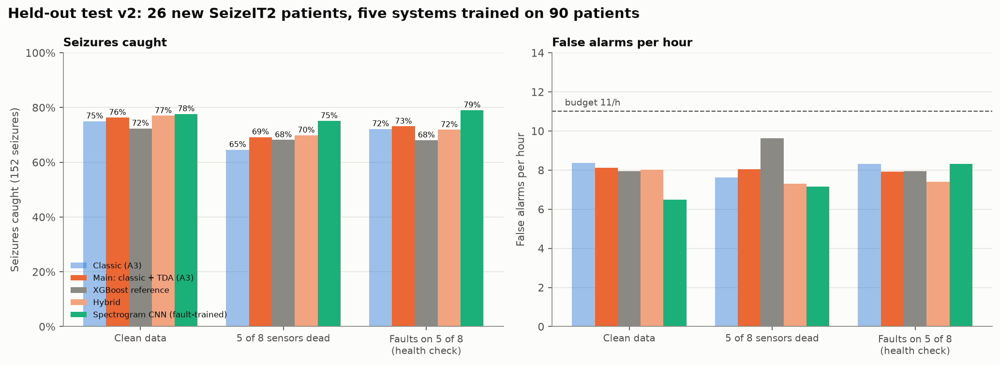
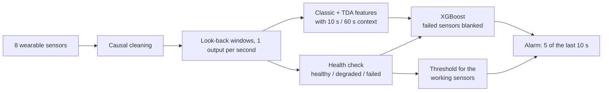

# Seizure detection under mid-recording sensor faults

**Research question.** How robust are persistent-homology (topological data analysis, TDA) features to sensor faults that begin partway through a recording (electrode pops and motion artefacts, gradual signal decline, intermittent dropout) in multimodal wearable seizure detection (EEG, ECG, EMG, motion), compared with standard feature-based and deep-learning detectors?

Existing TDA-based seizure-detection studies generally assume that every channel stays intact for the whole recording. This project studies channels that work at first and then fail, degrade or drop out mid-recording, which is the situation a wearable monitor faces in practice.

Final-year B.Tech project, VJTI Mumbai, October 2026.

**Authors:** Harsh Jagtap ([@hmjag07](https://github.com/hmjag07)) and Anya Agrawal ([@Anya-Agrawal-05](https://github.com/Anya-Agrawal-05))  
**Supervisor:** Dr. Gyanesh Singh

## Main results

Final systems, trained on 90 SeizeIT2 training patients and tested on 26 held-out patients (152 seizures). All thresholds were chosen on training patients only. "Mean drop" is clean sensitivity minus sensitivity under the condition, averaged over the sensor sets tested (dead-sensor sets with at least one EEG channel working; fault scenarios with the health check on).

| System | Clean data: seizures caught [95% CI] | False alarms / h | 5 of 8 sensors dead: caught (mean drop) | Faults on 5 of 8 sensors: caught (mean drop) |
|---|---|---|---|---|
| **Classic + TDA features, XGBoost (main)** | **76.3% [69.0, 82.4]** | **8.1** | 69.2% (7.1 points) | 73.1% (3.2 points) |
| Classic features only, XGBoost | 75.0% [67.6, 81.2] | 8.4 | 64.6% (10.4 points) | 72.2% (2.8 points) |
| Spectrogram CNN + GRU | 77.6% [70.4, 83.5] | 6.5 | 75.1% (2.5 points) | 79.0% (no drop) |

- **Robustness target met.** The target, fixed before any results, was that sensitivity drops by at most 15 percentage points when 60% of sensors (5 of 8) fail, with at least one EEG channel working. Under injected faults the main system met it in all 12 fault conditions and all 72 sensor sets; with dead sensors, in 11 of 12 sets.
- **The health check is essential.** With a full dropout on 5 sensors, the main system catches 27.2% of seizures without the health check and 69.6% with it.
- **What TDA adds is robustness, not clean accuracy.**
  - Clean data: no significant gain over classic features (+1.3 points, p = 0.44).
  - 5 of 8 sensors dead: +4.6 points [1.3, 9.2], p < 0.001 (patient bootstrap).
  - Injected faults: +2.4 points in cross-validation (p = 0.019), but not significant on the held-out patients (+0.9, p = 0.39).
- **Second dataset (CHB-MIT, 18 scalp EEG channels, cross-validation).** TDA features add 3.8 to 4.6 points in every condition, all with 95% intervals above zero. Every robustness target is met there too.
- **Real time.** About 86 ms of processing per second of data on a laptop CPU. Filters, features and alarms use past samples only; per-patient normalisation is the exception (see Limitations).



Full results, method and limitations: [docs/results.md](docs/results.md).

## Method in brief



1. **Data.** EDF recordings streamed from the public SeizeIT2 and CHB-MIT buckets with HTTP range requests. Only the needed seconds are fetched, and no raw data is stored in this repository.
2. **Features, every second.** 37 classic features (EEG band powers, line length, heart rate and its variability, muscle and movement measures) and 56 TDA features (persistent homology of each signal's delay embedding), plus their 10 s mean and its change against the minute before.
3. **Faults.** Electrode pops, gradual decline and intermittent dropout are injected at 25, 50, 75 and 100% severity, starting partway through each chunk. Because the faults are injected in code, the ground truth (which sensor, when, how badly) is known for every second.
4. **Health check.** A three-class model (healthy, degraded, failed) for each sensor every second, with smoothing and hysteresis, plus a rule for motion axes that are stuck at their full-scale value. Failed sensors are switched off.
5. **Robust training and thresholds.** The model is trained on copies of the data with random sensors removed and with injected faults. The alarm threshold for each set of working sensors is chosen in advance on other patients, at no more than 8 false alarms per hour; results are judged against a budget of 11 per hour.
6. **Evaluation.** Patient-grouped 5-fold cross-validation; a held-out patient group (SeizeIT2 sub-097 to sub-125); any-overlap sensitivity and false alarms per hour, following the SeizeIT2 benchmark; patient-level bootstrap for confidence intervals and p-values.

## Limitations

- **Seizure-centred data.** Test data is concentrated around seizures (10 minutes either side, plus five times the seizure duration as distant background). False-alarm rates are therefore not directly comparable with benchmarks on full 24-hour recordings.
- **Held-out group used twice.** The held-out patients were scored twice: v1, then v2 after the weaknesses v1 revealed had been fixed on training patients. Both runs are reported, and nothing was changed after either run, but the group is no longer untouched.
- **Normalisation.** Each patient's features are normalised with statistics from that patient's whole recording (labels unused). A deployed monitor would need a calibration period.
- **Simulated faults.** Real motion-sensor failures found in SeizeIT2 were also tested (Phase C4), but the other fault types are simulations.
- **Untuned models.** Model settings are defaults.
- **Small test set.** 26 held-out patients give confidence intervals of about ±7 points on clean sensitivity.

## Repository layout

```
docs/
  results.md          final method, results and limitations (start here)
  research-log.md     complete chronological record: every step, experiment, decision and number
  data-access.md      how the data is streamed, decoded, converted to physical units and checked
src/seizure/
  data/               streaming, labels, patient selection, fetch plans, cleaning, windows, dataset adapter
  features/           classic features, TDA-A (delay embedding), TDA-B (sensor network), feature builds
  faults/             fault injection, window-level fault labels, health check, fault evaluation
  models/             XGBoost training, robustness tests, CNNs, phase experiments, held-out tests
  evaluation/         scoring (sensitivity, false alarms, AUROC, AUPR) and all figures
results/
  README.md           index of every table and figure, and which are final
  tables/             CSV results
  figures/            PNG figures
```

## Datasets

- [SeizeIT2](https://openneuro.org/datasets/ds005873) (primary): 125 patients with focal epilepsy; behind-the-ear EEG, ECG, EMG and motion. Bhagubai et al., arXiv:2502.01224 (2025).
- [CHB-MIT](https://physionet.org/content/chbmit/1.0.0/) (second): scalp EEG, 24 recordings of 23 people, mostly children; PhysioNet.

## Reproducing

Requires Python 3.10 or later; the results were produced with Python 3.14.3. The first feature build streams about 85 hours of signal and takes several hours. The fault build takes about a day of CPU time on 6 cores. The CNNs need a CUDA GPU.

```
python -m venv .venv
.venv\Scripts\activate                 # Windows;  source .venv/bin/activate on Linux/macOS
pip install -r requirements.txt        # exact versions used for the results
pip install -e .                       # the seizure package itself
pip install torch==2.11.0 --index-url https://download.pytorch.org/whl/cu128   # CNN models only
```

Every step is a module run with `python -m`. For example:

```
python -m seizure.data.pilot                   # select the 30 pilot patients
python -m seizure.data.fetch_plan              # plan which seconds to stream
python -m seizure.features.build params        # choose the TDA delay and dimension
python -m seizure.features.build features      # stream, clean and compute features
python -m seizure.models.train                 # first cross-validated models
python -m seizure.evaluation.plots_phases      # figures from the saved tables
```

The full order of runs, and the environment variables that select a patient set (`SEIZURE_SET=pilot|extra|heldout`), are given step by step in [docs/research-log.md](docs/research-log.md). Derived data goes to `cache/`, which is git-ignored and can be rebuilt from the online sources.

## Licence

The code is released under the [MIT Licence](LICENSE). The datasets are not part of this repository and remain under their own licences: SeizeIT2 on OpenNeuro and CHB-MIT on PhysioNet.
