# Pipeline

Research question: how robust are persistent-homology features to mid-recording sensor faults (electrode pops/motion artefacts, gradual signal decline, intermittent dropout) in multimodal wearable seizure detection, compared with standard feature-based and deep-learning detectors?

Persistent homology (TDA) is the main method. A classic-feature model and a small CNN are baselines.

## Overview

```
 1. EXTRACT DATA     stream labels → plan time ranges → stream only those ranges → clean → window
        │
 2. INJECT FAULTS    create damaged copies (pops, decline, dropout) at known times
        │
 3. HEALTH CHECK     per sensor, per window: healthy / degraded / failed
        │
 4. FEATURES         TDA-A: delay embedding per signal
                     TDA-B: network of sensors
                     (+ classic features and raw signal for the baselines)
        │
 5. TRAIN            classifier on features + health scores, with random sensor failures
        │
 6. TUNE             TDA settings, model settings, alarm threshold
        │
 7. RUN "LIVE"       stream recordings second by second, as a monitor would
        │
 8. EVALUATE         how much worse each model gets under each fault → results for the paper
```

---

## Step 1: Extract the data

Data is streamed from the online sources and never stored in the repo. [data-access.md](data-access.md) explains the file formats, how streaming works byte by byte, how stored numbers become physical units, and every check that was run.

**Progress (2026-10-17):**

| Part | Status | Where |
|---|---|---|
| 1.1 Understand both datasets | ✓ Done | This section, [data-access.md](data-access.md) |
| 1.2 Pick pilot patients | ✓ Done: 30 patients, 189 seizures | [`pilot.py`](../src/seizure/data/pilot.py), [`pilot_patients.csv`](../results/tables/pilot_patients.csv) |
| 1.3 Streaming and unit conversion | ✓ Done and verified | [`streaming.py`](../src/seizure/data/streaming.py) |
| 1.3 Fetch plan | ✓ Done: 304 chunks, 85.4 h | [`fetch_plan.py`](../src/seizure/data/fetch_plan.py), [`fetch_plan.csv`](../results/tables/fetch_plan.csv) |
| 1.4 Clean the signals | ✓ Done, incl. gravity calibration and broken-sensor detection | [`preprocess.py`](../src/seizure/data/preprocess.py) |
| 1.5 Windows and labels | ✓ Done: 298,625 windows, 13,356 seizure | [`windows.py`](../src/seizure/data/windows.py) |
| 1.6 Balance | ✓ Set by the fetch plan | |
| 1.7 Feature build (with Steps 4A, 4C) | ✓ Done for all 30 patients | [`build.py`](../src/seizure/features/build.py), [`report.py`](../src/seizure/features/report.py) |

### 1.1 Datasets

#### SeizeIT2 (primary)

OpenNeuro `ds005873`, organised in the BIDS standard. Recorded 2020–2022 in five European epilepsy monitoring units (Leuven, Freiburg, Aachen, Karolinska, Coimbra) using the Sensor Dot wearable, alongside the hospital's standard video-EEG. All patients have focal epilepsy.

| Property | Whole dataset | Training range (sub-001 to sub-096), as scanned |
|---|---|---|
| Patients | 125 | 96 |
| Recording hours | about 11,640 | 8,715 |
| Runs (continuous recordings) | | 2,072 (median 1.0 h, longest 24.2 h) |
| Seizures | 886 | 702 |

**Signals per run** (16 when everything is present):

| Modality | Signals | Sampling rate | Notes |
|---|---|---|---|
| EEG | `BTEleft SD`, `CROSStop SD` | 256 Hz | Behind-the-ear electrodes: one same-side channel and one cross-head channel, placed on the side where seizures were expected to start. |
| ECG | `ECG SD` | 256 Hz | Chest |
| EMG | `EMG SD` | 256 Hz | Left deltoid (upper arm) |
| Motion, neck device | `EEG SD ACC X/Y/Z`, `EEG SD GYR A/B/C` | 25 Hz | 3 accelerometer + 3 gyroscope axes |
| Motion, chest device | `ECGEMG SD ACC X/Y/Z`, `ECGEMG SD GYR A/B/C` | 25 Hz | 3 accelerometer + 3 gyroscope axes |

**Which modalities each run has** (training range):

| Modalities present | Runs | Share |
|---|---|---|
| EEG + ECG + EMG + motion | 1,867 | 90.1% |
| EEG + ECG + EMG (no motion) | 181 | 8.7% |
| EEG + motion (no ECG, no EMG) | 22 | 1.1% |
| EEG only | 2 | 0.1% |

EEG is always present. The missing modalities are real technical failures and setup errors, so the dataset itself shows that sensors fail in practice: the motivation for this project.

**Labels** are in each run's `eeg/..._events.tsv`: start time, duration, seizure type, hemisphere, brain lobe, and whether the patient was awake or asleep. Other event types are `bckg` (no seizure) and `impd` (staff checking electrode contact, which produces artefacts). The codes are explained in `events.json` and in [data-access.md](data-access.md#the-label-files-eventstsv).

**Seizure types in the training range** (702 seizures):

| Group | Meaning | Seizures | Share |
|---|---|---|---|
| FIA | Focal impaired awareness | 289 | 41% |
| FA | Focal aware | 274 | 39% |
| other | Unknown awareness, unknown onset or unclassified | 106 | 15% |
| FBTC | Focal to bilateral tonic-clonic (convulsive) | 33 | 5% |

Awake: 344 (49%), asleep: 274 (39%), unknown: 84 (12%). The most common specific codes are `sz_foc_a_m_hyperkinetic` (146), `sz_foc_ia_nm` (105) and `sz_foc_ia_m_hyperkinetic` (88).

**Official split** (from the SeizeIT2 paper): sub-001 to sub-096 for training, sub-097 to sub-125 for validation. This project uses sub-097 to sub-125 as its final, untouched test set. The rules for using it were fixed before it was read (2026-10-23, [`heldout.py`](../src/seizure/data/heldout.py)); results are in Step 8 (Final test on held-out patients).

#### CHB-MIT (second)

PhysioNet `chbmit/1.0.0`. Scalp EEG recorded at Boston Children's Hospital.

| Property | Value |
|---|---|
| Patients | 22 (23 cases; chb21 is a later recording of chb01) |
| Channels | About 23 bipolar scalp channels. The project uses the 18 shared across nearly all recordings. `T8-P8` appears twice in many files (identical copies). |
| Sampling rate | 256 Hz |
| Files | One EDF per hour |
| Labels | `chbXX-summary.txt` |

CHB-MIT has many EEG channels but no ECG or motion, so it complements SeizeIT2: it tests the network-of-sensors features (TDA-B, Step 4B) where there are enough nodes to form meaningful shapes.

### 1.2 Pilot patients

#### Why a pilot subset

Processing all 96 training patients would not fit the one-week model deadline, especially because persistent homology is slow. A subset of 30 patients is large enough for 5-fold cross-validation grouped by patient (6 test patients per fold) and small enough to process quickly. More patients can be added in weeks 2–3.

#### How they were chosen

The patients were **not** hand-picked for expected good results. That would be cherry-picking: the model would only learn easy cases, then do worse on the untouched test patients, and reviewers would rightly question it. Instead, the rules below were fixed first, written down, and then applied by code ([`pilot.py`](../src/seizure/data/pilot.py)). Anyone can re-run it and get the same 30 patients.

| # | Rule | Why |
|---|---|---|
| 1 | Scan only sub-001 to sub-096 | sub-097 to sub-125 are the final test set. Their labels are not even read, so nothing about them can influence choices. |
| 2 | A seizure counts only if its run has all four modalities (EEG, ECG, EMG, motion) | The project tests what happens when sensors fail. A seizure recorded without ECG or motion cannot be used to test ECG or motion failing. This is checked **per run**, not per patient, because some patients have all modalities in some runs but not others. |
| 3 | A patient is eligible with **at least 3** such seizures | Patients with 1–2 seizures contribute very little to learn from, and with 30 slots, each one should carry real data. |
| 4 | Draw **30** eligible patients **at random**, seed 42 | Random choice avoids selection bias. The fixed seed makes the draw reproducible. |
| 5 | **Balance check:** the pilot's share of each seizure type and of sleep seizures must be within **15 percentage points** of the eligible pool's | Guards against an unlucky draw (e.g. almost no sleep seizures). If it had failed, the plan was to redo the draw within groups (stratified sampling). |
| 6 | Use at most **10 seizures per patient**, chosen at random with the same seed | A few patients have dozens of seizures (sub-039 has 75). Without a cap they would dominate what the model learns. |

#### What happened at each rule

| Stage | Patients | Runs | Seizures |
|---|---|---|---|
| SeizeIT2, all | 125 | | 886 |
| Rule 1: training range | 96 | 2,072 | 702 |
| Rule 2: seizures in runs with all 4 modalities | 87 with at least one | 1,867 | 631 (71 dropped) |
| Rule 3: at least 3 usable seizures | **50 eligible** | | 581 |
| Rule 4: random draw | **30 pilot** | 752 (744 with all 4 modalities) | 357 |
| Rule 6: cap of 10 per patient | 30 | | **189 used** |

Why the 46 patients were not eligible:

| Usable seizures | Patients |
|---|---|
| 0 | 9 (sub-048, 049, 054, 058, 081, 082, 087, 090, 091) |
| 1 | 24 |
| 2 | 13 |

The 50 eligible patients: sub-001, 002, 004, 011, 012, 015, 021, 022, 025, 026, 028, 029, 030, 031, 034, 035, 036, 039, 040, 042, 043, 044, 046, 047, 050, 051, 052, 055, 056, 059, 060, 062, 064, 066, 067, 068, 071, 072, 073, 074, 076, 077, 079, 080, 084, 085, 086, 089, 092, 094.

#### The 30 pilot patients

| # | Patient | Usable seizures | Used (after cap) | Usable seizures during sleep | Seizure types (usable) | Hours with all 4 modalities |
|---|---|---|---|---|---|---|
| 1 | sub-002 | 15 | 10 | 5 | FA:2, FIA:13 | 99.2 |
| 2 | sub-004 | 4 | 4 | 1 | FA:4 | 18.5 |
| 3 | sub-015 | 9 | 9 | 5 | FBTC:1, FIA:8 | 88.6 |
| 4 | sub-021 | 4 | 4 | 3 | FIA:4 | 111.8 |
| 5 | sub-022 | 7 | 7 | 1 | FIA:7 | 113.5 |
| 6 | sub-025 | 3 | 3 | 1 | FA:2, FBTC:1 | 98.0 |
| 7 | sub-031 | 3 | 3 | 1 | FA:2, FBTC:1 | 107.3 |
| 8 | sub-034 | 30 | 10 | 9 | FIA:30 | 95.3 |
| 9 | sub-035 | 55 | 10 | 55 | FA:55 | 72.3 |
| 10 | sub-039 | 75 | 10 | 56 | FA:35, other:40 | 91.9 |
| 11 | sub-040 | 3 | 3 | 0 | FIA:3 | 53.7 |
| 12 | sub-043 | 5 | 5 | 0 | FIA:5 | 87.7 |
| 13 | sub-046 | 4 | 4 | 3 | FA:2, FBTC:2 | 97.6 |
| 14 | sub-055 | 8 | 8 | 8 | other:8 | 42.2 |
| 15 | sub-056 | 13 | 10 | 9 | FIA:13 | 62.7 |
| 16 | sub-060 | 25 | 10 | 3 | FA:22, other:3 | 48.5 |
| 17 | sub-064 | 3 | 3 | 0 | FA:2, FBTC:1 | 41.3 |
| 18 | sub-066 | 4 | 4 | 0 | FIA:2, other:2 | 117.8 |
| 19 | sub-067 | 4 | 4 | 0 | FIA:4 | 35.6 |
| 20 | sub-071 | 6 | 6 | 0 | FIA:3, other:3 | 194.8 |
| 21 | sub-072 | 20 | 10 | 9 | FIA:20 | 126.1 |
| 22 | sub-076 | 3 | 3 | 0 | FIA:3 | 86.6 |
| 23 | sub-077 | 9 | 9 | 0 | FA:7, FIA:2 | 61.6 |
| 24 | sub-079 | 15 | 10 | 0 | FA:1, FBTC:1, FIA:13 | 95.5 |
| 25 | sub-080 | 8 | 8 | 0 | FBTC:1, FIA:7 | 149.1 |
| 26 | sub-084 | 4 | 4 | 0 | FIA:4 | 55.0 |
| 27 | sub-086 | 4 | 4 | 0 | FA:1, FIA:2, other:1 | 84.3 |
| 28 | sub-089 | 5 | 5 | 0 | FIA:5 | 102.5 |
| 29 | sub-092 | 6 | 6 | 0 | FIA:6 | 106.3 |
| 30 | sub-094 | 3 | 3 | 0 | FIA:3 | 43.8 |
| | **Total** | **357** | **189** | **169** | | **2,589** |

The list is also in [`configs/default.yaml`](../configs/default.yaml) (`pilot_patients`), and every seizure with its `used` flag is in [`seizeit2_seizures.csv`](../results/tables/seizeit2_seizures.csv).

#### Balance check (rule 5)

| | Eligible pool (581 seizures) | Pilot, before cap (357) | Within 15 points? | Pilot, after cap (189 used) |
|---|---|---|---|---|
| FA (focal aware) | 38% | 38% | ✓ | 24% |
| FIA (focal impaired awareness) | 44% | 44% | ✓ | 61% |
| FBTC (tonic-clonic) | 3% | 2% | ✓ | 4% |
| other | 15% | 16% | ✓ | 11% |
| During sleep | 44% | 47% | ✓ | 32% |

The random draw matched the eligible pool closely, so no stratified redraw was needed.

#### Things to know about this pilot set

1. **The cap shifts the mix.** After capping, FIA rises from 44% to 61% and sleep seizures fall from 47% to 32%. The patients who lost the most seizures to the cap were mostly FA and asleep: sub-035 (55 seizures, all FA, all asleep) and sub-039 (75, mostly asleep). This is the intended effect of giving each patient an equal voice, and should be stated in the paper.
2. **Few tonic-clonic seizures (7 used).** These large convulsive seizures are the easiest for motion sensors to catch. With so few, results describe mainly the harder, quieter focal seizures, which is realistic for this dataset. The paper should not make specific claims about tonic-clonic seizures.
3. **sub-067 has a real sensor fault:** its neck accelerometer Z axis is stuck at maximum for 96% of an hour checked ([data-access.md](data-access.md#56-a-real-sensor-fault-sub-067)). It stays in the pilot, because real faults are part of what is being studied, and the health check (Step 3) should flag it.

#### Output files

| File | Contents |
|---|---|
| [`results/tables/pilot_patients.csv`](../results/tables/pilot_patients.csv) | One row per pilot patient (the table above) |
| [`results/tables/seizeit2_seizures.csv`](../results/tables/seizeit2_seizures.csv) | All 702 training-range seizures: patient, run, onset, duration, type, group, vigilance, hemisphere, lobe, whether its run has all modalities, and whether it is `used` |
| [`results/tables/seizeit2_runs.csv`](../results/tables/seizeit2_runs.csv) | All 2,072 training-range runs: modalities present and length. Needed to sample background data (1.6). |

Re-run with `PYTHONPATH=src python -m seizure.data.pilot`.

### 1.3 Stream only what is needed

The pipeline never streams whole recordings. It first decides exactly which stretches of signal are needed (the **fetch plan**), then streams only those, processes them in memory, and keeps only the computed features.

1. Fetch the label files only (tiny) to find every seizure. ✓ Done in 1.2.
2. Plan the time ranges needed (the fetch plan, below). ✓ Done.
3. Fetch those ranges with HTTP range requests, one request per chunk, not per window. ✓ [`build.py`](../src/seizure/features/build.py)
4. Convert stored numbers to physical units. ✓ `read_physical`, verified (below).
5. Process in memory: clean, window, compute features. ✓ (fault injection comes in Step 2)
6. Keep only the features (see caching in [data-access.md](data-access.md#8-caching)). Discard the raw signal. ✓ `cache/features/<subject>.parquet`

#### The fetch plan ([`fetch_plan.py`](../src/seizure/data/fetch_plan.py), 2026-10-16)

The plan is a list of **chunks**: continuous stretches of one run, each with a start and end time and a purpose. Two kinds:

**Seizure chunks.** Each of the 189 used seizures, plus **10 minutes before and 10 minutes after**. When two seizures in the same run are close enough that their chunks overlap, the chunks are merged, so no second is fetched twice.

Why 10 minutes either side:
- It gives the model normal-looking data right next to each seizure, which is the hardest background to tell apart from seizure onset.
- Faults in Step 2 must start "partway through" a recording, and the gradual-decline fault develops over minutes. 10 minutes leaves room for both.

**Background chunks.** 10-minute stretches with no seizure, which teach the model what normal looks like (sleep, walking, eating, talking). For each patient:

| Rule | Value | Why |
|---|---|---|
| Amount | 5 × the patient's used seizure time, rounded up to whole 10-minute chunks | Matches the 1:5 ratio of the SeizeIT2 benchmark, so results are comparable |
| Distance from **any** seizure in the run | at least 30 minutes | Brain activity can stay abnormal for a while before and after a seizure. This includes seizures that were *not* used because of the 10-per-patient cap, so a real seizure can never be labelled as background. |
| Distance from impedance checks (`impd`) | at least 1 minute | Staff testing electrodes produces artefacts that look like sensor faults and would confuse the health check |
| Where | Any run of the patient with all four modalities, on a 10-minute grid, chosen at random (seed 42) | Random placement covers day and night in proportion |

**Warm-up.** Every chunk is fetched starting **30 seconds early**. Causal filters need a few seconds to settle, and the 15-second ECG window must be full before the first output. No output is produced during the warm-up.

**Result:**

| | Chunks | Hours of signal |
|---|---|---|
| Seizure chunks (with 10 min context) | 180 (189 seizures; some merged) | 63.7 |
| Background chunks | 124 | 21.7 |
| **Total** | **304** | **85.4** (about 0.9 GB streamed, nothing stored) |

Every patient received its full background quota. Four patients (sub-035, 039, 043, 067) have only one background chunk because their used seizures are very short (52–119 s in total), so 5× that fits in 10 minutes. The plan is saved in [`results/tables/fetch_plan.csv`](../results/tables/fetch_plan.csv) (columns: subject, run, kind, t0, t1, fetch_t0, hours).

**Unit conversion, summary of checks** (full details in [data-access.md](data-access.md#5-checking-the-conversion-is-correct-2026-10-15)):

| Check | Expected | Result | Status |
|---|---|---|---|
| ECG heart rate (sub-001, 3 times of day) | 50–80 beats/min | 59–66 beats/min | ✓ pass |
| Behind-the-ear EEG amplitude | low tens of µV | 7–14 µV | ✓ pass |
| CHB-MIT scalp EEG amplitude | tens of µV | 40–58 µV | ✓ pass |
| All 2,976 pilot files continuous, 1 s records, lengths match labels | yes | yes | ✓ pass |
| Accelerometer at rest (gravity) | 1 g | 0.5 or 0.167, depending on patient | ✗ dataset problem, fixed in 1.4 |
| Gyroscope unit | degrees/s | labelled `g` | ✗ dataset problem, normalise per patient |

#### Signal names differ between patients

A survey of all 182 runs in the fetch plan found:

| Modality | Variants | Runs |
|---|---|---|
| EEG | `BTEleft SD` + `CROSStop SD` | 81 |
| | `BTEleft SD` + `BTEright SD` | 57 |
| | `BTEright SD` + `CROSStop SD` | 44 |
| ECG, EMG | always `ECG SD`, `EMG SD` | 182 |
| Motion | both devices, all 12 axes | 174 |
| | neck gyroscope missing | 5 |
| | whole neck device missing | 3 |

The three EEG layouts come from electrode placement chosen per patient (the side where seizures were expected to start; both ears for patients suspected of generalised seizures). So that every patient has the same inputs, the two EEG channels are renamed by position: **`EEG1`** is the first channel in the file (always a lateral behind-the-ear channel, `BTEleft` or `BTEright`) and **`EEG2`** the second. Missing motion signals simply produce empty (NaN) features for those runs, which the classifier in Step 5 handles natively.

### 1.4 Clean the signals ([`preprocess.py`](../src/seizure/data/preprocess.py))

All filters are **causal**: the output at time *t* uses only samples up to *t* (`scipy.signal.sosfilt`/`lfilter`, never the zero-phase `filtfilt`, which looks into the future). This is required because Step 7 simulates a live monitor.

| Signal | Cleaning | Why |
|---|---|---|
| EEG (`EEG1`, `EEG2`) | 4th-order Butterworth band-pass 0.5–40 Hz, then 50 Hz notch (Q = 30) | Removes slow drift and high-frequency noise; 50 Hz is European mains interference (all SeizeIT2 centres are in Europe). |
| ECG | Band-pass 0.5–40 Hz; heartbeats detected later for heart rate (4C) | Heart rate and its variability change during many seizures. |
| EMG | 4th-order high-pass 20 Hz | Muscle activity is high-frequency; this removes movement and drift. |
| Accelerometer (`ACC_neck`, `ACC_chest`) | Gravity calibration (below), total acceleration `√(x²+y²+z²)`, minus 1 g, low-pass 10 Hz | Leaves only the acceleration caused by movement, comparable across patients. |
| Gyroscope (`GYR_neck`, `GYR_chest`) | Rotation magnitude `√(a²+b²+c²)`, low-pass 10 Hz | Unit is unreliable (labelled `g`), so only relative values are used after normalisation. |

This gives **8 cleaned signals** per run: `EEG1`, `EEG2`, `ECG`, `EMG`, `ACC_neck`, `ACC_chest`, `GYR_neck`, `GYR_chest`.

**Accelerometer gravity calibration.** The accelerometer values in SeizeIT2 are on two inconsistent scales: gravity reads about 0.5 for some patients and 0.167 for others, instead of 1 g ([data-access.md](data-access.md#54-accelerometer-gravity)). A still accelerometer always measures exactly 1 g of gravity, whichever way it is tilted. So for each device in each run:
1. Stream the motion data of all of the run's chunks (motion is small: 25 Hz).
2. Split it into 10-second blocks. A block counts as **rest** if its total acceleration varies by less than 2% of its mean. (A relative threshold is needed because the raw scale itself differs by patient.)
3. Take the median total acceleration over the rest blocks: that reading corresponds to 1 g.
4. Divide all three axes by it.
5. If a run has no rest block, use the patient's median over their other runs.

This is the standard method for calibrating wearable accelerometers using gravity (van Hees et al., *J. Appl. Physiol.* 2014). Without it, "total acceleration" would mean different things for different patients, and a model could learn to tell device configurations apart instead of detecting seizures. The scale is a fixed property of the device setup, so estimating it from the recording is equivalent to a calibration done at device setup.

**Broken motion sensors in the real data.** The first full build (2026-10-16) produced gravity scales of about 32.77 for every run of sub-066 and sub-086 and some runs of sub-067 and sub-084, and about 0 for two runs. Inspecting the raw stored values showed three kinds of genuine sensor failure in the published dataset:

| Failure | Example | What the stored values look like |
|---|---|---|
| Dead axis | sub-021 run 05, neck X and Y | Exactly 0 for the whole chunk (1 distinct value) |
| Saturated / frozen axis | sub-066 run 04, chest Z: 100% at the minimum; neck Z: 74% at the maximum | Pinned at the edge of the range |
| Axis stored on a different scale | sub-086, Z axes | Header range ±32.768 instead of about ±1 g, so values are about 30× too large |

Calibrating such data produces nonsense, so broken sensors are now detected and **left out** (their features become empty, NaN), never "repaired":
- An axis is **stuck** in a chunk if it is constant for the whole chunk, or sits exactly at its own minimum or maximum for more than half of it. If any axis of a device is stuck, that device's accelerometer (or gyroscope) gives no features for that chunk. A healthy axis at rest also repeats one value (a still gyroscope reads 0), but that value lies inside its range rather than at an edge, so it is not flagged. A first, simpler rule ("one value in more than half the samples") wrongly flagged healthy resting gyroscopes and was replaced.
- A gravity scale outside **0.1–1.5** marks that run's accelerometer as unusable. It does not borrow another run's scale.

Applied to the motion data of all 304 planned chunks:

| Signal | OK | Stuck | Missing |
|---|---|---|---|
| ACC_neck | 275 | 24 | 5 |
| ACC_chest | 279 | 25 | 0 |
| GYR_neck | 283 | 5 | 16 |
| GYR_chest | 300 | 4 | 0 |

33 chunks (11%) have at least one stuck motion sensor, across 10 patients (sub-066 and sub-086: 8 chunks each; sub-067: 5; sub-084: 4; sub-021, sub-077: 2; sub-031, sub-043, sub-055, sub-092: 1). These are real, unplanned sensor failures in clinical data, which is direct evidence for this project's motivation. They also mean the "clean" data already contains some faults, so the health check (Step 3) must be evaluated with that in mind.

**Per-patient normalisation.** Each cleaned signal is normalised per patient: subtract the median and divide by a **robust standard deviation** (1.4826 × the median absolute deviation, MAD). The statistics come from the patient's **background chunks only**, so seizure data never influences the normalisation. Median and MAD are used instead of mean and standard deviation because artefacts produce extreme values that would drag the mean and inflate the standard deviation.

### 1.5 Windows and labels ([`windows.py`](../src/seizure/data/windows.py))

The model produces **one output every second**. At each whole second *t*, every signal contributes the window that **ends** at *t* (it looks back only, as a live monitor would):

| Signals | Window | Samples per window | Why |
|---|---|---|---|
| EEG, EMG | last 4 s | 1,024 (256 Hz) | Long enough to capture seizure rhythms (a few Hz) several times over |
| Motion | last 4 s | 100 (25 Hz) | Same timing as EEG |
| ECG | last 15 s | 3,840 (256 Hz) | Contains about 15–20 heartbeats, enough for a stable heart rate and heart-rate variability |

Windows are cut with `numpy.lib.stride_tricks.sliding_window_view`, which creates views into the signal without copying it, so a 20-minute chunk does not multiply memory use by the window overlap. Outputs are produced only where every available signal has a full window.

**Label rule.** A window ending at *t* is labelled **seizure (1)** if its newest second, (*t* − 1, *t*], overlaps a seizure in the run's label file; otherwise **background (0)**.

This is stricter than the original wording ("the window overlaps a seizure"). With 4 s windows (15 s for ECG), "any overlap" would keep labelling windows as seizure for up to 15 seconds after the seizure ended, and every signal would get a different label for the same second. Labelling by the newest second gives one label per second, the same for all signals, and answers the question a live monitor asks: "is the patient having a seizure *now*?". It is also consistent with the 1-second segments used by the SeizeIT2 benchmark's alarm rule (Step 6).

All seizures in the run are used for labels, including those not selected by the 10-per-patient cap, so a seizure that happens to fall inside another seizure's context is still labelled correctly.

Each window also gets an **`impd`** flag (1 if its newest second overlaps an impedance check), so those seconds can be excluded or analysed separately.

### 1.6 Balance

Balance is set by the fetch plan (1.3): every second of every seizure, 20 minutes of context around each seizure, and 5× the seizure time as distant background. Class weights in training (Step 5.4) handle the remaining imbalance.

### 1.7 Running it: the feature build ([`build.py`](../src/seizure/features/build.py))

Steps 1.3–1.6 and the features of Step 4 (TDA-A and classic) run together, patient by patient:

```
PYTHONPATH=src python -m seizure.features.build params     # choose TDA τ and m (Step 4A), once
PYTHONPATH=src python -m seizure.features.build features   # all 30 pilot patients
PYTHONPATH=src python -m seizure.features.report           # summary tables below
```

For each patient:
1. **Gravity scales.** Stream the motion file for every chunk; estimate the accelerometer scale per device per run, ignoring chunks with a stuck axis (1.4).
2. **Normalisation statistics.** Stream and clean the background chunks; compute each signal's median and robust standard deviation.
3. **Every chunk.** Stream all four modalities in parallel; clean; normalise; cut 1-second windows; label; compute classic and TDA-A features.
4. **Save** one row per window to `cache/features/<subject>.parquet` (git-ignored). The raw signal is discarded.

**Memory.** Only about 3 GB of RAM was free, so chunks are processed one at a time and **4 patients run in parallel** (one process each, 170–300 MB per process). TDA-A dominates the running time.

**Output table**, one row per second:

| Columns | Content |
|---|---|
| `subject`, `run`, `kind`, `t` | Which patient, run, chunk type (seizure/background) and second |
| `label` | 1 = seizure, 0 = background (1.5) |
| `impd` | 1 if an impedance check overlaps this second |
| 37 classic features (including `ECG_hr`, `ECG_rmssd`) | Step 4C |
| 56 TDA-A features | Step 4A |

#### Build results (2026-10-16/17)

All 30 pilot patients were processed without errors. About 5 hours of total processing time across the 4 parallel workers.

| | Windows (seconds) | Seizure windows | Impedance-check windows |
|---|---|---|---|
| Seizure chunks (with 10 min context) | 224,101 | 13,356 | 325 |
| Background chunks | 74,524 | 0 | 0 |
| **Total** | **298,625** | **13,356 (4.5%)** | **325** |

The 13,356 seizure windows match the 189 used seizures, whose durations add up to 13,259 s. The extra 97 come from seizures not selected by the cap that fall inside another seizure's context; they are labelled correctly (1.5).

**Missing features** (highest share of empty values among each signal's features):

| Signal | Missing | Cause |
|---|---|---|
| EEG1, EEG2, EMG | 0% | |
| ECG (heart rate, RMSSD) | 0.7% | Fewer than 3 clean beats in the 15 s window (artefact) |
| GYR_chest | 1.0% | Stuck axes |
| GYR_neck | 6.7% | Neck gyroscope missing in some runs, or stuck |
| ACC_chest | 8.9% | Stuck or wrongly scaled axes |
| ACC_neck | 12.7% | Neck device missing (sub-015), stuck or wrongly scaled axes |

**Gravity calibration** across the 179 runs processed:

| Outcome | Device-runs | Scale |
|---|---|---|
| Working, configuration A | 287 | 0.107–0.218 (most 0.16–0.17) |
| Working, configuration B | 32 | 0.39–0.61 (sub-002, sub-004, sub-039, sub-040) |
| Accelerometer unusable for the whole run | 39 (22 neck, 17 chest) | sub-015 neck (device missing in all 6 runs); sub-066, sub-067, sub-086 (most or all runs); sub-084 run 49 chest |

The two working configurations match the 3:1 ratio found in [data-access.md](data-access.md#54-accelerometer-gravity), and after calibration both read 1 g at rest.

---

## Step 2: Inject faults ([`inject.py`](../src/seizure/faults/inject.py), [`build_faulty.py`](../src/seizure/faults/build_faulty.py))

Clean signals are damaged deliberately in code, so it is known exactly what is broken, when, and how badly.

**Progress (2026-10-23):** ✓ Done for all 30 pilot patients: 3 fault types × 4 severities × 8 sensors, about 17.5 million faulty seconds.

### 2.1 The three faults

Each fault damages one sensor's **raw** signal (before cleaning) from an onset time onwards, at a severity `s` between 0 and 1. Sizes are relative to the signal's own robust spread before the onset (`scale` = 1.4826 × MAD), so the same severity means the same damage on every sensor. For motion sensors the scale is at least 5% of gravity, because a still axis barely varies.

| Fault | What it imitates | How it is simulated |
|---|---|---|
| **Electrode pop** | A loose electrode or a knock to the sensor | Sudden steps that decay back. Number per minute ~ Poisson(6 × s); size = s × 20 × scale × random(0.5–1), random sign; decay time 0.3–2 s |
| **Gradual decline** | Rising electrode impedance (gel drying, contact loosening) | Over 5 minutes the signal shrinks and noise grows: `y = x × (1 − s·p) + noise × s·p × scale`, where `p` rises from 0 to 1 over the 5 minutes. At s = 1 the signal ends as pure noise |
| **Intermittent dropout** | A connection cutting in and out | Flat bursts at zero, each 0.5–5 s long, covering a share `s` of the time after the onset. At s = 1 the sensor is dead from the onset |

For each fault the code also records the **effective severity** at every sample (0 before the onset; `s` after it for pops and dropout; `s × p`, growing, for decline). This is the ground truth for the health check (Step 3).

Checks on synthetic data: the signal before the onset is untouched; pops reach up to 33× the normal spread at full severity; dropout flattens 25%, 51% and 100% of the time at 25%, 50% and 100% severity.

### 2.2 How the faulty data is built

- **Onset partway through.** For every chunk, fault and severity, the onset is drawn at random between 20% and 60% of the way through the chunk (seeded, reproducible). Seizure chunks are about 20 minutes long, so faults start both before and after seizures.
- **One sensor at a time.** A fault on one sensor changes only that sensor's features. So each sensor is damaged on its own, and its features (classic and TDA-A, Step 4) are recomputed **for the seconds after the onset only**. Every combination of faulty sensors ("EEG2 and ECG popping", "5 of 8 declining") is then assembled later by swapping in the affected sensors' features, with no recomputation. The onset is the same for every sensor of a condition, so combinations line up.
- **Cleaning without look-ahead.** The whole-chunk "stuck axis" check (Step 1.4) is not used on faulty data, because it would see a fault that starts later and remove the sensor from the beginning. `preprocess.clean_one` cleans one sensor without it.
- **Sensors already broken in the clean data** (Step 1.4) are skipped.
- **Storage.** One row per second, fault, severity and sensor, with generic column names (`linelen`, `TDA_H1_max`, `q_flat`, …) and a `sensor` column. This keeps memory about 10× lower than one column per sensor. Output: `cache/faults/<subject>_faulty.parquet` and `<subject>_quality.parquet` (git-ignored).

**Cost.** Each patient's signal is streamed once and every condition applied in memory. About 35 hours of processing in total (6 patients in parallel, about 6 hours of wall time), dominated by TDA. One patient was finished before a pause and the build resumed for the other 29.

**A small data issue found here.** Two adjacent background chunks share their boundary second, which happens once in the data (sub-055, run 01, second 14,430). It is kept once everywhere from Step 3 on; it does not affect any earlier result.

---

## Step 3: Health check ([`health.py`](../src/seizure/faults/health.py), [`train_health.py`](../src/seizure/faults/train_health.py))

For every sensor, every second, decide whether it is **healthy, degraded or failed**. Failed sensors are switched off: their features are blanked and the sensor-aware threshold for the remaining sensors is used (Step 6).

**Progress (2026-10-23):** ✓ Done.

### 3.1 Quality features

Computed per sensor per window; none depends on the sensor's units, so one recipe serves every sensor.

| Feature | Formula | Responds to |
|---|---|---|
| `q_logstd` | log₁₀ of the spread of the normalised, cleaned window | Dropout (falls), decline (changes) |
| `q_range` | max − min of the normalised window | Pops |
| `q_kurt` | kurtosis of the cleaned window | Spiky windows (pops) |
| `q_flat` | share of consecutive raw samples that are identical | Flat bursts (dropout) |
| `q_jump` | largest raw sample-to-sample jump ÷ the median one | Sudden steps (pops) |

**Context**, within each sensor's series, past seconds only: the 10 s mean and its change against the minute before (`_m10`, `_d60`), the largest jump in the last 60 s (`q_jump_max60`, remembers pops), the mean flat share over the last 60 s (`q_flat_m60`, remembers dropouts), and the strength now against 5 minutes ago (`q_logstd_d300`, slow decline). Plus which sensor it is (8 indicator columns): 26 inputs in total.

Each fault leaves a clear fingerprint (sub-025, medians): dropout's flat share rises from 0.04 (healthy) to 0.27 / 0.55 / 0.82 / 1.00 with severity; pops' largest jump from 8 to 10 / 13 / 23 / 42.

### 3.2 Labels and training

```
effective severity = 0            → healthy
0 < effective severity < 0.6      → degraded   (still used)
effective severity ≥ 0.6          → failed     (switched off)
```

XGBoost, 3 classes, 300 trees, the same 5 patient-grouped folds as the seizure model. To fit in memory, a random 20% of **whole series** (one sensor, one chunk, one fault condition) is kept: 3.76 million seconds (0.46 M healthy, 1.82 M degraded, 1.48 M failed). Whole series rather than single seconds keep time continuous for smoothing. A faulty series includes the clean seconds before its onset, so the context features see the change.

### 3.3 The switch-off decision

The failed-probability is averaged over the last 15 s; the sensor is switched off when that average reaches a cut-off, and back on only after 30 s in a row below it (hysteresis, so decisions do not flicker). The cut-off of each fold is chosen on the other folds' patients as the one with the best F1 for "failed", which balances failed sensors left on against working sensors switched off. It came out at 0.5 in every fold.

```
smoothed(t) = mean of p_failed over seconds t−14 … t
F1(failed)  = 2 × (switched off and truly failed) ÷ (switched off + truly failed)
```

### 3.4 Results

*First version, with severity labels (3.2). The final version uses window-level labels: see 3.7.*

**Most likely class, per second** (rows = truth):

| Truth ↓ / answer → | Healthy | Degraded | Failed |
|---|---|---|---|
| Healthy | **83.7%** | 14.7% | 1.6% |
| Degraded | 4.4% | **81.3%** | 14.3% |
| Failed | 0.9% | 19.5% | **79.6%** |

**Switch-off decisions**, first version (failed if most likely, no memory or smoothing) vs final:

| Truth | Switched off, first version | Switched off, final |
|---|---|---|
| Failed (should be off) | 79.6% | **85.9%** |
| Degraded (should stay on) | 14.3% | 19.0% |
| Healthy (should stay on) | 1.6% | 1.7% |

**Faulty seconds flagged** (degraded or failed):

| Fault | 25% | 50% | 75% | 100% |
|---|---|---|---|---|
| Decline | 99.2% | 99.2% | 99.2% | 99.2% |
| Dropout | 92.0% | 98.1% | 99.3% | 99.6% |
| Pops | 88.1% | 96.2% | 98.0% | 98.6% |

**Speed** (50% severity, share flagged by time since onset): decline 35% within 5 s and 99% within 30 s; dropout 43% and 95%; pops 23% and 74%, reaching 92% within a minute. Pops are slowest because the check must see several before it is sure.

**Healthy sensors switched off:** EEG1 0.2%, EEG2 0.1%, ECG 1.9%, EMG 0.7%, movement 0–0.5%, chest rotation 2.1%, **neck rotation 8.1%**. A still gyroscope reads exactly the same value for long stretches, which looks like a dropout.

### 3.5 What limits it

Almost all confusion is between degraded and failed at 50–75% severity, next to the 0.6 line:
- **Intermittent faults are labelled by their overall severity, not by what is in the window.** Between pops, a 75%-severity window can look clean (median largest jump 12 when called degraded, 44 when called failed). The model is often describing the window correctly and the label is too blunt.
- **A decline crosses 0.6 gradually,** so seconds near the line are ambiguous.

Longer memory alone changed little (failed called degraded: 19.9% → 19.5%); smoothing with a chosen cut-off gave the gain. Labelling each window by whether its data is actually damaged ("fix D") targets the first cause directly: see 3.7.

### 3.6 Caveats
- At 25% severity a decline is already caught 99% of the time, because the added noise is sized against the raw signal's spread, which includes slow drift. Real mild declines are likely subtler.
- These are injected faults with known truth. The real broken motion sensors found in Step 1.4 are a natural further test.

### 3.7 Window-level labels ("fix D", 2026-10-23; [`window_labels.py`](../src/seizure/faults/window_labels.py))

**Why.** With severity labels (3.2), every second after an intermittent fault's onset got the fault's overall label, even when the window itself was clean (between pops) or completely flat (inside a dropout burst of a "degraded" 50% dropout). The seizure-model evaluation (Step 8) showed the cost: partial dropouts (25–50%) stayed switched on while half their windows were flat.

**What changed.** Each faulty window is labelled by what the fault did **inside that window**:

| Fault | Measured in the window | Failed | Degraded | Healthy |
|---|---|---|---|---|
| Dropout | share of samples flattened | ≥ 0.5 | > 0 | 0 |
| Pop | largest added step, in units of the signal's spread | ≥ 5 | ≥ 1 | < 1 (no pop, or faded) |
| Decline | effective severity at the window's end (unchanged) | ≥ 0.6 | > 0 | 0 |

The cut-offs (half flat; 5× and 1× the spread) are judgement calls.

**How, without recomputing features.** The faults were generated from seeded random numbers whose use does not depend on the signal's values. Replaying `inject()` on arrays of ones with the same length, start, seed and channel order reproduces where every pop and flat burst fell. Checked against the real fault build on brain, heart and motion sensors at two severities each: identical flat samples and identical pop steps (zero difference). 16.6 million window labels, about 15 s per patient.

**Effect on the labels** (share of faulty windows):

| Fault, severity | Healthy | Degraded | Failed | Severity label was |
|---|---|---|---|---|
| Dropout 25% | 27% | 33% | 40% | all degraded |
| Dropout 50% | 8% | 21% | 71% | all degraded |
| Dropout 75% | 1% | 8% | 91% | all failed |
| Pop 25% | 75% | 25% | 0.5% | all degraded |
| Pop 75% | 38% | 9% | 53% | all failed |
| Pop 100% | 28% | 9% | 64% | all failed |

**Health check retrained on window labels** (same features, smoothing and cut-off selection; cut-offs 0.5–0.55):

| | Severity labels | Window labels |
|---|---|---|
| Truly failed, called failed | 79.6% | **87.3%** |
| Truly failed, called degraded | 19.5% | **8.7%** |
| Truly degraded, called degraded | 81.3% | 70.4% |
| Healthy EEG1 / EEG2 switched off | 0.2% / 0.1% | 0.1% / 0.1% |
| Healthy ECG / EMG switched off | 1.9% / 0.7% | 3.0% / 0.6% |
| Healthy chest / neck gyroscope switched off | 2.1% / 8.1% | **15.7% / 22.2%** |

The confusion between failed and degraded is more than halved. The side effect is on the gyroscopes: the model now learns that "partly flat" means failed, and a still gyroscope repeats the same value for long stretches. They are among the least informative sensors, and the detection results in Step 8 include this effect. Results of the first version are kept as `results/tables/health_*_severity_labels.csv`.

---

## Step 4: Feature extraction

### 4A. TDA-A: delay embedding (per signal) ([`tda_embedding.py`](../src/seizure/features/tda_embedding.py))

Captures rhythm and pattern within each signal.

#### The idea

A single signal is a list of numbers over time. **Delay embedding** turns it into a cloud of points: each point is the signal value now and a few values slightly later,

```
point(t) = ( x[t], x[t+τ], x[t+2τ], …, x[t+(m−1)τ] )
```

where **τ** (tau) is the delay in samples and **m** the number of coordinates (the embedding dimension). A regular rhythm, such as the repetitive discharges of a seizure or a heartbeat, makes these points trace a **loop**, because the signal keeps returning to the same sequence of values. Irregular background activity produces a shapeless **blob**.

**Persistent homology** measures that shape. Imagine growing a ball around every point. As the balls grow, nearby points join into clusters, and rings of points close into loops; later, clusters merge and loops fill in. Each cluster (H0) and each loop (H1) has a **birth** (the size at which it appears) and a **death** (the size at which it disappears). Its **persistence** (death − birth) says how real the feature is: long-lived loops are genuine rhythms, short-lived ones are noise. The library `ripser` computes this.

#### Steps per window

1. Take one normalised window of one signal (e.g. 4 s of EEG = 1,024 samples).
2. Build the delay embedding with that signal's fixed τ and m (table below).
3. Keep **150 points**, evenly spaced in time. (EEG gives about 1,000 points, ECG about 3,800, motion about 85, which stays as is.)
4. Compute persistent homology up to H1 (clusters and loops).
5. Summarise each diagram with a few numbers:

| Feature | Meaning |
|---|---|
| `H0_total` | Sum of all cluster lifetimes: how spread out the point cloud is |
| `H0_max` | Longest cluster lifetime: the largest gap in the cloud |
| `H0_entropy` | Persistent entropy of clusters: how evenly the lifetimes are spread |
| `H1_count` | Number of loops |
| `H1_total` | Sum of loop lifetimes |
| `H1_max` | Longest-lived loop: the strength of the dominant rhythm |
| `H1_entropy` | Persistent entropy of loops: one dominant loop (low) or many similar ones (high) |

Persistent entropy is `−Σ pᵢ log pᵢ`, where `pᵢ` is each feature's lifetime divided by the total lifetime.

This gives **7 features × 8 signals = 56 TDA-A features** per second, named `TDA_<signal>_<feature>` (e.g. `TDA_EEG1_H1_max`).

#### Choosing τ and m (once, on training data)

τ and m must be fixed before training, using pilot (training) patients only, never the test patients.

- **τ: first minimum of the average mutual information** (AMI). Mutual information measures how much knowing `x[t]` tells you about `x[t+lag]`. At lag 0 it is maximal; it falls as the lag grows. The first minimum is the smallest delay at which the two coordinates carry mostly new information, without being so far apart that they are unrelated. Computed with 16 quantile bins, lags up to 64 samples (256 Hz signals) or 10 samples (25 Hz signals).
- **m: false nearest neighbours** (FNN; Kennel et al., *Phys. Rev. A* 1992). In too few dimensions, points that are far apart in reality get squashed together and look like neighbours ("false neighbours"). Increase m one step at a time and stop at the first m where fewer than 5% of nearest neighbours are false. Thresholds: distance ratio 10 and attractor-size ratio 2, the values from Kennel et al. Capped at m = 6.

Procedure ([`build.py params`](../src/seizure/features/build.py)): 10 pilot patients drawn at random (seed 42); from each, the first background chunk, cleaned and normalised (broken motion sensors excluded); 20 random windows per signal; τ and m computed for each window; the **median** taken per signal. Result ([`tda_params.csv`](../results/tables/tda_params.csv)):

| Signal | τ (samples) | τ (ms) | τ middle 50% | m | m middle 50% | Windows |
|---|---|---|---|---|---|---|
| EEG1 | 6 | 23 | 5-10 | 5 | 4-6 | 200 |
| EEG2 | 7 | 27 | 5-11 | 5 | 4-6 | 200 |
| ECG | 13 | 51 | 8-19 | 5 | 5-6 | 200 |
| EMG | 2 | 8 | 2-4 | 6 | 3-6 | 200 |
| ACC_neck | 3 | 120 | 2-3 | 6 | 6-6 | 180 |
| ACC_chest | 3 | 120 | 2-3 | 6 | 6-6 | 180 |
| GYR_neck | 3 | 120 | 2-3 | 6 | 4-6 | 180 |
| GYR_chest | 3 | 120 | 2-3 | 6 | 4-6 | 180 |

(Motion signals have 180 windows instead of 200 because one of the 10 sampled patients, sub-066, has broken motion sensors in that chunk, which are left out (Step 1.4). Each patient and signal uses its own random stream (seeded from 42), so leaving out one signal never changes which windows another signal gets.)

EEG and ECG settle at m = 5, within the usual 3–5 range. EMG and motion reach the cap of 6: these signals are noisy and irregular, so false neighbours never fall below 5%. That is common for noisy signals and is accepted rather than raising the cap, because higher dimensions on only about 85 motion points would make the shape less meaningful, not more.

#### Why 150 points instead of 300

The plan said "about 300 points". Persistent homology gets much slower as the number of points grows. Measured with `ripser` on this machine (2026-10-16), for a noisy loop in 3 dimensions:

| Points | Time per diagram | × 8 signals per second |
|---|---|---|
| 100 | 7.5 ms | 0.06 s |
| 150 | 20.8 ms | 0.17 s |
| 200 | 35.5 ms | 0.28 s |
| 300 | 129.9 ms | 1.04 s |

At 300 points, TDA alone would take about 1 second of computation for every second of data: no time left for anything else in a live monitor, and days of computation offline. 150 points keeps the 8 signals within the real-time target (≤ 0.2 s per second, success target T7) while still tracing loops clearly (the test loop's H1 persistence was 1.57 at 150 points vs 1.62 at 300).

#### Speed on real windows

Measured on 300 real background windows (sub-004), while the feature build was using the other cores ([`features_speed.csv`](../results/tables/features_speed.csv)):

| Signal | Points per cloud | TDA-A time per window |
|---|---|---|
| EEG1, EEG2 | 150 | 9.5 ms each |
| ECG | 150 | 8.8 ms |
| EMG | 150 | 10.1 ms |
| ACC_neck, GYR_neck, ACC_chest, GYR_chest | 85 | 2.8–5.7 ms each |
| **All 8 signals** | | **≈ 56 ms per second of data** |
| All 37 classic features | | 0.2 ms per second of data |

**56 ms per second is well under the 0.2 s real-time target (T7)**, leaving room for the health check, TDA-B and the classifier.

#### Do the features separate seizure from background?

Before training any model, each feature was tested **on its own**. Method ([`report.py`](../src/seizure/features/report.py)):
1. Normalise each feature within each patient: subtract the median and divide by the robust standard deviation of that patient's background windows. This removes patient-to-patient differences, as the classifier will see them.
2. Pool all 30 patients and compute the **AUROC** of the single feature for seizure vs background.

AUROC is the probability that a randomly chosen seizure window has a higher value than a randomly chosen background window. 0.5 means no information; 1.0 (or 0.0) means perfect separation. "Separation" below is |AUROC − 0.5|, so features that are *lower* during seizures count too.

**Top 15 features** (all 93 in [`features_auroc.csv`](../results/tables/features_auroc.csv)):

| Rank | Feature | Family | AUROC |
|---|---|---|---|
| 1 | `TDA_EEG2_H1_total` | TDA-A | 0.801 |
| 2 | `TDA_EEG2_H0_total` | TDA-A | 0.799 |
| 3 | `EEG2_alpha` | classic | 0.789 |
| 4 | `EEG2_linelen` | classic | 0.780 |
| 5 | `EEG2_logpow` | classic | 0.780 |
| 6 | `EEG2_beta` | classic | 0.777 |
| 7 | `EEG2_std` | classic | 0.770 |
| 8 | `TDA_EEG1_H0_total` | TDA-A | 0.770 |
| 9 | `TDA_EEG1_H1_total` | TDA-A | 0.768 |
| 10 | `EEG2_theta` | classic | 0.767 |
| 11 | `EEG1_alpha` | classic | 0.766 |
| 12 | `TDA_EEG2_H0_max` | TDA-A | 0.757 |
| 13 | `EEG1_linelen` | classic | 0.756 |
| 14 | `EEG1_theta` | classic | 0.755 |
| 15 | `EEG1_beta` | classic | 0.753 |

**Best single feature per signal:**

| Signal | Best TDA-A separation | Best classic separation |
|---|---|---|
| EEG2 | 0.301 | 0.289 |
| EEG1 | 0.270 | 0.266 |
| GYR_neck | 0.221 | 0.225 |
| ACC_neck | 0.216 | 0.214 |
| GYR_chest | 0.203 | 0.211 |
| ACC_chest | 0.202 | 0.200 |
| ECG | 0.200 | 0.216 |
| EMG | 0.141 | 0.128 |

What this shows:
- **EEG carries the most information**, as expected; EEG2 (the second, usually cross-head channel, whose electrodes are further apart) is slightly better than EEG1.
- **TDA-A is on par with the classic features on every signal**, and the single best feature overall is topological.
- **Every modality carries some information** (separation 0.14–0.30), so when EEG fails, the remaining sensors are not useless. This is what the robustness experiments rely on.

#### Caveat: the strongest TDA features largely measure amplitude

Persistent homology is computed on per-patient normalised signals, not per-window normalised ones, so a larger window gives a larger point cloud and longer bars. Spearman correlation between TDA-A features of EEG2 and the classic EEG2 features (all 298,625 windows):

| TDA-A feature | Highest |correlation| with any classic EEG2 feature | Kind |
|---|---|---|
| `H0_total` | 0.96 (with `std`) | Size |
| `H0_max` | 0.90 | Size |
| `H1_max` | 0.90 (with `std`) | Size |
| `H1_total` | 0.84 | Size |
| `H1_entropy` | 0.58 | Shape |
| `H1_count` | 0.57 | Shape |
| `H0_entropy` | 0.35 | Shape |

The **size** features (total and longest bars) are largely a topological measure of amplitude, which is why they rank so high: seizures are larger. The **shape** features (entropy, loop count) are much less related to the classic features, so they are where TDA can add information the classic model does not have. ECG is a good example: `TDA_ECG_H1_max` has correlation −0.04 with heart rate.

This matters for the paper's claim. Step 5 must show that TDA adds something beyond amplitude, through ablations (classic only vs classic + TDA shape features vs classic + all TDA). A possible addition, **not yet done**, is a second TDA-A variant computed on each window scaled to unit variance, which removes amplitude entirely and keeps pure shape.


### 4B. TDA-B: network of sensors
Captures how sensors move together. During a seizure, regions synchronise and sensors across modalities change together.

1. **Nodes:**
   - SeizeIT2: 2 EEG + ECG + EMG + 2 motion devices × (3 accelerometer + 3 gyroscope axes) = 16 nodes. The 12 motion axes are strongly correlated within each device, so using per-device acceleration and rotation magnitudes instead (2 EEG + ECG + EMG + 4 magnitudes = 8 nodes) is an option to compare.
   - CHB-MIT: 18 EEG channels.
2. **Distance** between each pair of healthy nodes = 1 − similarity (correlation or a frequency-based similarity).
3. **Persistent homology** on the distance matrix.
4. **Features** that don't depend on node count: how early nodes merge (synchronisation), and how many loops form and how long they persist.
5. **Failed sensors are left out of the network.**

Why it helps with robustness: persistent homology is stable, so small changes to the point set give small changes to the diagram. Removing a redundant sensor should barely change the shape. That gives the paper a testable hypothesis:

> Topological features of the sensor network degrade gracefully when redundant sensors fail, more gracefully than features tied to specific channels.

Limitation: 8–16 nodes in SeizeIT2, many of them motion axes that move together, gives limited shape, so TDA-B is expected to be stronger on CHB-MIT and TDA-A to carry more weight on SeizeIT2.

### 4C. Baseline features ([`classic.py`](../src/seizure/features/classic.py))

Standard hand-crafted features used in wearable seizure detection, computed on the same windows as TDA-A. They feed the classic baseline model (Step 5.6) and are also available to the main model.

| Signal | Feature | How it is computed | What it captures |
|---|---|---|---|
| EEG1, EEG2 | `delta`, `theta`, `alpha`, `beta`, `gamma` | Welch power spectrum (1 s segments, 1 Hz resolution), log₁₀ power in 1–4, 4–8, 8–13, 13–30, 30–40 Hz | Seizures shift power between frequency bands, often into theta and beta |
| | `logpow` | log₁₀ power over 1–40 Hz | Overall EEG strength |
| | `linelen` | Mean absolute difference between consecutive samples | Rises sharply with fast, large seizure activity; a classic seizure feature |
| | `std` | Standard deviation | Amplitude |
| ECG | `hr` | Median interval between heartbeats in the last 15 s, as beats per minute | Heart rate often rises at seizure onset (ictal tachycardia) |
| | `rmssd` | Root mean square of successive differences between beat intervals, in ms | Heart-rate variability, which changes with the nervous system's state |
| EMG | `logrms` | log₁₀ of the standard deviation | Muscle activation strength |
| | `linelen` | as above | Fast muscle activity |
| | `zcr` | Fraction of samples where the signal changes sign | Dominant frequency of muscle firing |
| ACC_neck, ACC_chest, GYR_neck, GYR_chest | `mean`, `std`, `max`, `linelen` | Of the movement magnitude | How much and how abruptly the patient moves |

That is **8 × 2 EEG + 2 ECG + 3 EMG + 4 × 4 motion = 37 classic features** per second.

**Heartbeat detection.** Beats are found once per chunk, then counted in each 15-second window:
1. Band-pass 5–20 Hz (where the sharp QRS spike of each beat has most of its energy), square, and smooth with a 0.1 s moving average. This turns each beat into one clear bump, whatever the ECG's polarity.
2. Find bumps at least 0.3 s apart (heart rates up to 200 beats/min).
3. Keep a bump only if it is higher than 30% of the 99th percentile of the **previous 10 seconds**.
4. In each window, keep beat intervals between 0.3 and 2.0 s (30–200 beats/min). With at least 3 intervals, compute heart rate and RMSSD; otherwise leave them empty.

The local, past-only threshold in step 3 matters. The first version used one threshold for the whole chunk (30% of its 99th percentile). On sub-004, a single minute of large artefact (signal 10× normal) raised that threshold so much that normal beats in the rest of the chunk fell below it, and heart rate was missing in **41%** of windows (95% in the worst chunk). With the 10-second local threshold, an artefact only affects the following 10 seconds, and missing heart rate fell to **0–1.8% per chunk**. It also removed a small look-ahead (the chunk-wide percentile used future samples), so the detector is now fully causal.

**Raw windows** are the input to the CNN baseline (Step 5.6) and are not stored; they are re-streamed when the CNN is trained.

Features are cached for each version of the data (clean, and each fault type and severity), because persistent homology is the slowest step.

---

## Step 5: Train ([`train.py`](../src/seizure/models/train.py))

**Progress (2026-10-20):**

| Part | Status |
|---|---|
| 5.1–5.2 Classifier on clean data | ✓ Done: XGBoost, 3 feature sets |
| 5.3 Sensor-dropout augmentation | ✓ Done (dead sensors); faults of other types come with Step 2 |
| 5.4 Class imbalance | ✓ Class weights |
| 5.5 Patient-grouped 5-fold CV | ✓ Done |
| 5.6 Classic baseline | ✓ Done. CNN baseline: to do |
| Clean-data target T1 (≥ 60% sensitivity at ≤ 11 FA/h) | ✓ **Met: 76.9% at 9.9 FA/h** |
| Robustness target (≤ 15-point drop with 5 of 8 sensors dead) | ✓ **Met on average with dropout training + sensor-aware threshold** (6.8 points); see Step 8 |

### 5.1 Inputs

Each second is one row of the feature table (Step 1.7). Before training, the table goes through two steps.

**1. Per-patient feature normalisation.** Every feature is turned into a robust z-score within its patient:

```
z = (x − median_patient) / (1.4826 × MAD_patient),     MAD = median(|x − median|)
```

The median and MAD are computed over **all** of the patient's seconds, **without using labels**. (Seizures are only 4.5% of seconds, so they barely move the median.) The factor 1.4826 makes MAD equal to the standard deviation for normally distributed data, so z is on the familiar scale. Median and MAD are used instead of mean and standard deviation because artefacts produce extreme values that would distort both.

This removes patient-to-patient differences: after it, "z = 3" means "3 robust standard deviations above this patient's typical value", whoever the patient is. It raised AUROC by 0.02–0.03 for every model (5.7).

*Caveat:* it uses each patient's whole recording, including later data. A real monitor would estimate the median and MAD from a calibration period at the start, or keep a running estimate. This must be stated in the paper.

**2. Short-term context features.** A single second judged in isolation is noisy, but seizures build up over several seconds. For each classic feature and the six main TDA-A summaries of each signal (`H0_total`, `H1_total`, `H1_max`, `H0_entropy`, `H1_count`, `H1_entropy`), two extra columns are added:

| Column | Formula | Meaning |
|---|---|---|
| `<feature>_m10` | mean of the feature over the last 10 s (t−9 … t) | Smoothed recent level |
| `<feature>_d60` | `_m10` at t − (mean over the 60 s ending at t−10) | How much the recent level changed compared with the minute before |

Both use past seconds only and are computed within each chunk, so they are possible in a live monitor. This was the single biggest improvement (5.7).

A failed or missing sensor's features stay empty (NaN); XGBoost learns where to send missing values at each split.

### 5.2 Classifier

**XGBoost** (gradient-boosted decision trees). It builds many small decision trees one after another; each new tree corrects the mistakes of the trees before it. It handles missing values natively, trains quickly on 300,000 rows, and shows which features it relies on.

| Setting | Value | Meaning |
|---|---|---|
| `n_estimators` | 400 | Number of trees |
| `max_depth` | 6 | Each tree asks at most 6 questions in a row |
| `learning_rate` | 0.05 | How strongly each tree corrects the previous ones (small = cautious) |
| `subsample`, `colsample_bytree` | 0.8, 0.8 | Each tree sees a random 80% of rows and features (reduces overfitting) |
| `min_child_weight` | 5 | Leaves need enough data behind them |
| `scale_pos_weight` | background ÷ seizure seconds in the training folds (about 21) | Class weighting, 5.4 |

These are reasonable defaults, not tuned yet (Step 6).

**Three feature sets**, trained on identical folds:

| Model | Inputs | Purpose |
|---|---|---|
| `classic` | 37 classic + 74 context = 111 | Baseline |
| `classic+TDA` | + 56 TDA-A + 96 TDA context = 263 | Main model |
| `classic+TDA_shape` | classic + only the TDA *shape* summaries (entropies, loop count) and their context = 183 | Tests whether TDA adds more than amplitude ([Step 4A caveat](#caveat-the-strongest-tda-features-largely-measure-amplitude)) |

### 5.3 Sensor-dropout augmentation ([`robustness.py`](../src/seizure/models/robustness.py) `dropout`)

**Why.** A model trained only on complete data has never seen a missing heart, muscle or brain sensor (only motion sensors were sometimes missing, because of real faults). When one disappears, its probabilities drift and a fixed threshold no longer fits: in the dead-sensor test (Step 8) the normally trained model fell from 76.9% to 25.1% of seizures caught with 5 of 8 sensors dead.

**How.** Each fold's training data is used twice: once as it is, and once as a copy in which every second loses a random number of sensors, blanked completely (all base, TDA and context features become missing):

```
k = random whole number from 1 to 6           (sensors that die in this second)
put the 8 sensors in a random order; the first k die
chance that a given sensor dies in a copied row = average k ÷ 8 = 3.5 ÷ 8 ≈ 44%
```

The model trains on both halves together (about 480,000 rows per fold). Its threshold is then chosen on **clean** data from the other folds' patients, exactly as in 5.7. A check of the copy found 1–6 dead sensors per row in equal proportions, every sensor dead in about 44% of rows, and never a partly blanked sensor. Fold models are saved to `cache/models/`.

**Effect on clean data** (all sensors working; same scoring as 5.8):

| Model | Normal training | Sensor-dropout training |
|---|---|---|
| Classic | 69.8% at 10.5 FA/h | 73.9% at 9.8 FA/h |
| Classic + TDA | 76.9% at 9.9 FA/h | 77.9% at 10.2 FA/h |
| Classic + TDA shape | 74.9% at 9.6 FA/h | 78.4% at 9.9 FA/h |

Practising with missing sensors also made every model slightly better with all sensors present, because it no longer leans on any single one. Its effect under sensor failure is in Step 8 (Robustness to dead sensors).

### 5.4 Class imbalance
Only 4.5% of seconds are seizure. Without correction, a model can score 95.5% accuracy by never predicting seizure. `scale_pos_weight` makes each seizure second count about 21 times as much as a background second during training, so both classes carry equal total weight.

### 5.5 Patient-level splits

A patient's data never appears in both training and testing. The 30 pilot patients are split into **5 folds of 6 patients** (`GroupKFold`, shuffled, seed 42). Each model is trained 5 times, on 24 patients, and predicts the 6 it never saw. Every second therefore gets an **out-of-fold** prediction from a model that has never seen that patient, which is what "cross-patient" means.

| Fold | Patients |
|---|---|
| 0 | sub-035, 039, 060, 066, 079, 089 |
| 1 | sub-002, 022, 046, 064, 080, 092 |
| 2 | sub-004, 015, 025, 043, 055, 077 |
| 3 | sub-021, 067, 076, 084, 086, 094 |
| 4 | sub-031, 034, 040, 056, 071, 072 |

### 5.6 Baselines
1. **Classic features + XGBoost:** ✓ done (`classic` above). Same data, folds, normalisation and context features as the TDA model, so the only difference is the TDA features.
2. **Small 1D CNN on raw windows**, with failed sensors filled with zeros: to do.

All models use the same data, splits and (later) fault augmentation.

### 5.7 How the models are scored ([`metrics.py`](../src/seizure/evaluation/metrics.py), [`alarm.py`](../src/seizure/models/alarm.py))

The model outputs a **probability** of seizure for every second. Two kinds of scores are reported.

**Per-second scores** (no threshold needed):

| Score | Meaning | Chance level here |
|---|---|---|
| **AUROC** | Probability that a random seizure second gets a higher probability than a random background second | 0.5 |
| **AUPR** | Average precision: how pure the alarms are (what fraction are real seizures) as the threshold is lowered to catch more seizures. Sensitive to false alarms when seizures are rare. | 0.045 (the seizure share) |

AUPR is the stricter score for rare events. A model can have a high AUROC while most of its "seizure" seconds are false, because the background is so large; AUPR exposes that.

**Seizure-level scores** (what a clinician experiences), following the SeizeIT2 benchmark:
1. **Threshold:** each second with probability ≥ threshold is a "seizure second".
2. **Alarm rule:** the alarm is on at second *t* if at least **5 of the last 10** seconds are seizure seconds. (The SeizeIT2 benchmark used 8 of 10; changed 2026-10-19, see Step 6.)
3. **Alarm events:** each continuous stretch of "alarm on" is one alarm.
4. **Sensitivity (any-overlap):** a seizure counts as **detected** if any alarm overlaps it. Sensitivity = detected seizures ÷ all seizures.
5. **False alarms:** alarms that overlap no seizure. Reported **per hour** of non-seizure data.
6. **Detection delay:** first alarm second inside the seizure minus the seizure onset.

**Choosing the threshold honestly.** The threshold decides the trade-off between catching seizures and raising false alarms. Picking it by looking at the test patients' results would flatter the scores. So, for each fold:
1. Take the out-of-fold predictions of the **other four folds** only.
2. Try thresholds 0.10, 0.15, …, 0.95, and pick the one with the highest sensitivity while staying at **≤ 11 false alarms per hour** (the budget from target T1).
3. Apply that threshold to the held-out fold.

The chosen thresholds were very stable (0.35–0.45 in every fold), so the result does not depend on a lucky choice.

### 5.8 Results on clean data (2026-10-19)

([`model_clean_summary.csv`](../results/tables/model_clean_summary.csv), [`model_clean_folds.csv`](../results/tables/model_clean_folds.csv))

| Model | Inputs | AUROC | AUPR | Seizures detected | Sensitivity | False alarms / h | Median delay |
|---|---|---|---|---|---|---|---|
| Classic | 111 | 0.804 | 0.253 | 139 / 199 | 69.8% | 10.5 | 8 s |
| **Classic + TDA** | 263 | **0.818** | 0.331 | **153 / 199** | **76.9%** | **9.9** | 10 s |
| Classic + TDA shape only | 183 | 0.816 | **0.336** | 149 / 199 | 74.9% | 9.6 | 11 s |

(199 seizure events: the 189 used seizures, plus seizures not selected by the cap that happen to fall inside another seizure's context window.)

**Success target T1 (≥ 60% sensitivity at ≤ 11 FA/h): met**, at 76.9% and 9.9 FA/h.

**Per fold, classic + TDA:**

| Fold | Threshold | AUROC | Sensitivity | False alarms / h |
|---|---|---|---|---|
| 0 | 0.35 | 0.740 | 55.6% | 12.3 |
| 1 | 0.35 | 0.796 | 84.2% | 8.0 |
| 2 | 0.35 | 0.732 | 76.5% | 10.3 |
| 3 | 0.35 | 0.892 | 95.5% | 10.4 |
| 4 | 0.35 | 0.907 | 92.9% | 8.5 |

Fold 0 is the weakest and slightly exceeds the false-alarm budget. It holds sub-035 and sub-039, which have many very short seizures.

**What the results show:**
1. **TDA improves on the classic baseline:** +7.1 points of sensitivity (69.8% → 76.9%) with fewer false alarms, and AUPR +31% (0.253 → 0.331).
2. **TDA adds more than amplitude.** The shape-only TDA features (entropies, loop count), which correlate only 0.35–0.58 with classic features, give almost the same gain and the best AUPR. This answers the Step 4A caveat.
3. **Short seizures remain hard.** Detection by seizure length (classic + TDA):

| Seizure length | ≤ 10 s | 11–20 s | 21–40 s | 41–80 s | > 80 s |
|---|---|---|---|---|---|
| Detected | 35% (7/20) | 67% (24/36) | 81% (30/37) | 81% (44/54) | 92% (48/52) |

#### Figures ([`plots.py`](../src/seizure/evaluation/plots.py), `python -m seizure.evaluation.plots`)

| Figure | Shows |
|---|---|
| 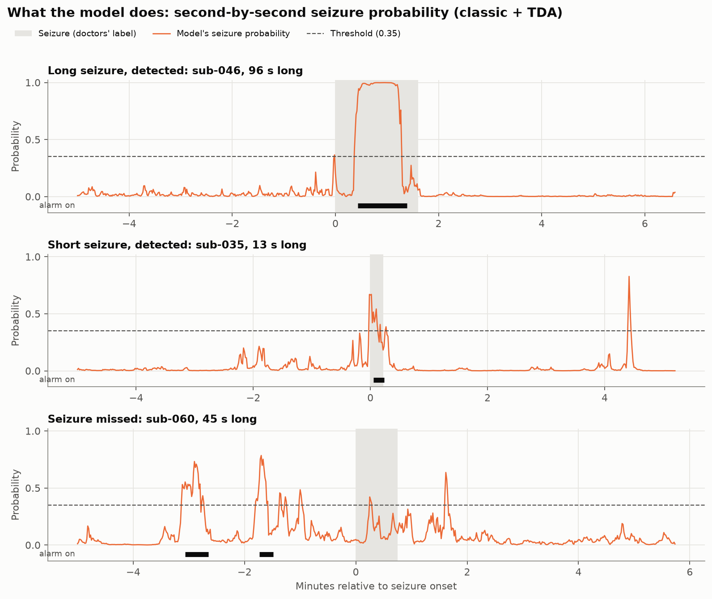 | **What the model does.** Second-by-second seizure probability around three real seizures: a long one detected, a short one detected, and one missed (with two false alarms a few minutes earlier). Grey band = seizure; dashed line = threshold; black bars = alarm on. |
| 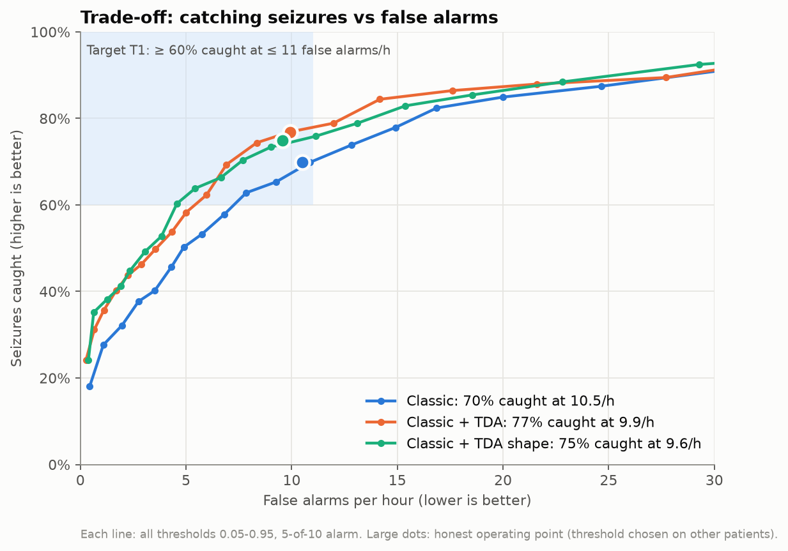 | **Trade-off curve.** Seizures caught vs false alarms per hour for every threshold. The blue box is target T1; the large dots are the honest operating points. TDA (orange, green) lies above the classic model (blue) almost everywhere. |
| 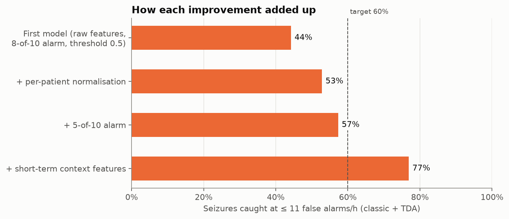 | **How each improvement added up**, from 44% to 77%. |
| 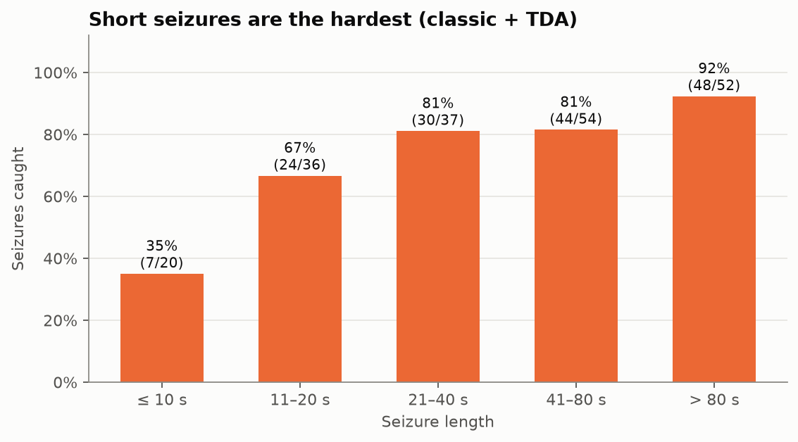 | **Detection by seizure length.** |
| 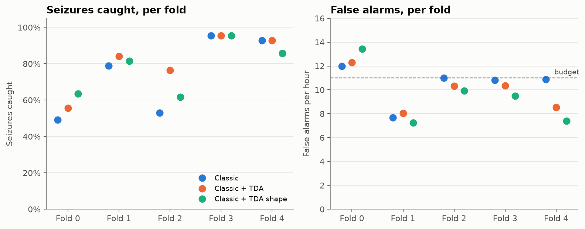 | **Per fold.** Sensitivity and false alarms for each group of 6 test patients; fold 0 is the hardest. |
| 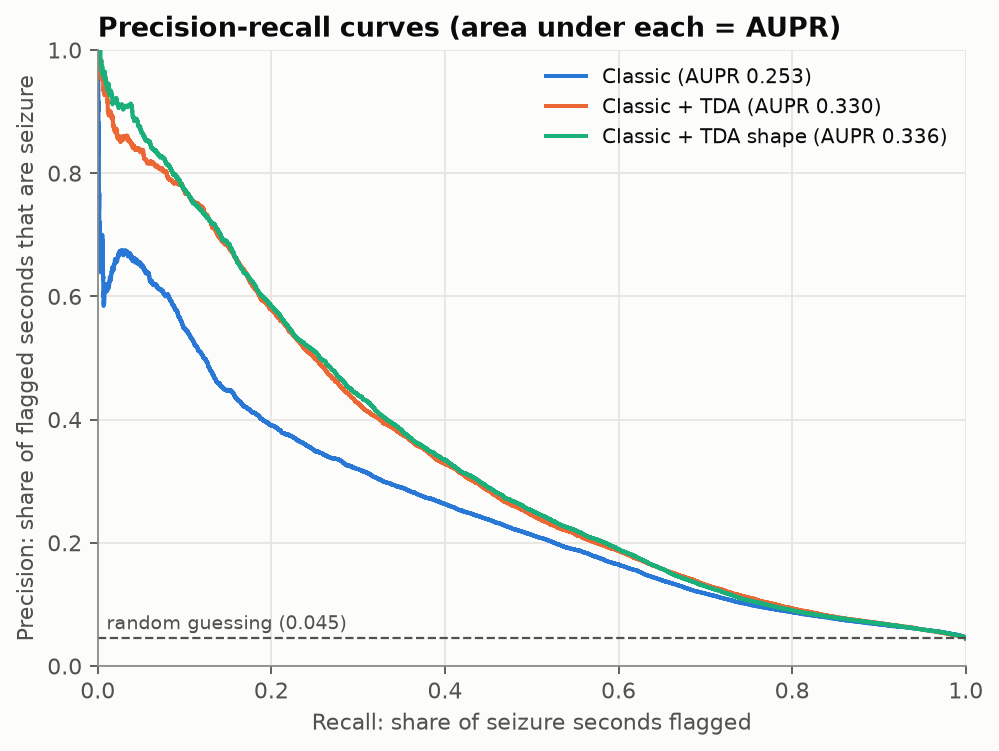 | **Precision–recall curves.** The area under each is the AUPR; the dashed line is random guessing (0.045). TDA's curves sit well above the classic one at every recall below about 0.6. |

#### How we got here: what each change contributed

Sensitivity at ≤ 11 FA/h, classic + TDA (the first row used a fixed threshold of 0.5; the rest use the honest per-fold threshold):

| Version | Sensitivity | FA/h | AUROC | AUPR |
|---|---|---|---|---|
| First model: raw features, 8-of-10 alarm, threshold 0.5 | 44.2% | 10.6 | 0.766 | 0.200 |
| + per-patient feature normalisation | 52.8% | 10.6 | 0.794 | 0.275 |
| + 5-of-10 alarm | 57.3% | 10.3 | 0.794 | 0.275 |
| + short-term context features | **76.9%** | **9.9** | **0.818** | **0.331** |

With context features, 5-of-10 and 8-of-10 detect almost the same number of seizures (77% vs 78% in the scratch run), because the context features already smooth the output. 5-of-10 raises the alarm sooner (median 10.5 s vs 13 s after onset), so it was kept.

#### Caveats
1. **Normalisation uses each patient's whole recording** (5.1). A deployed monitor needs a calibration period or running estimate.
2. **False alarms per hour are measured on the fetched data,** which is concentrated around seizures (20 minutes of context per seizure). That is harder than an average hour of recording, so the real-world rate is probably lower, but it is not directly comparable with the SeizeIT2 benchmark (71.1% at 11.0 FA/h on full recordings).
3. **Clean data only.** Robustness to sensor faults is the next experiment.
4. **The model settings are untuned defaults;** tuning (Step 6) may improve results further.

---

## Step 6: Tuning

1. **TDA settings:** window length, τ, m, number of points, which diagram summaries to use.
2. **Classifier:** depth, learning rate, number of trees (grid search or Optuna inside the grouped cross-validation).
3. **Alarm rule.**
   - ✓ **Probability threshold:** chosen per fold on the other folds' patients at ≤ 11 FA/h (5.7).
   - ✓ **X-of-Y rule: changed from 8 of 10 (the SeizeIT2 benchmark) to 5 of 10** (2026-10-19). With 8 of 10, a seizure shorter than about 8 seconds cannot trigger an alarm; in the first model only 1 of 20 seizures of ≤ 10 s was detected. With context features both rules detect about the same number of seizures, and 5 of 10 alarms about 2.5 s sooner.
   - ✓ **Sensor-aware threshold** (2026-10-20): one threshold per combination of working sensors, each chosen in advance on other patients at ≤ 11 FA/h. It turns dead-sensor robustness from a 51.8-point drop into 6.8 points (with dropout training); details in Step 8.
   - To do: weighting each second by its health scores.

   This sets the trade-off between sensitivity and false alarms.
4. **CHB-MIT:** same pipeline and code, but a **separate model**. Its sensors differ (18 scalp EEG channels, no ECG or motion), so the SeizeIT2 model can't be fine-tuned on it directly.

---

## Step 7: Simulated real-time run

```
for each second t in the recording:
    1. take the latest buffer of each sensor (4 s, or 10–20 s for ECG)
    2. health check  → health score per sensor
    3. features      → TDA-A + TDA-B, using healthy sensors only
    4. model         → seizure probability for second t
    5. alarm rule    → alarm on/off
    6. log: probability, alarm, health scores, processing time
```

- Use past data only; filters are causal.
- Faults start partway through, following the injected schedules.
- Processing time per second is measured. If it is well under 1 s, the method is suitable for real-time monitoring.

---

## Step 8: Evaluate

### Metrics (aligned with the SeizeIT2 benchmark)
- **Sensitivity**, using any-overlap scoring.
- **False alarms** per hour and per 24 h.
- **Detection delay.**
- **AUROC / AUPR.**
- **Fault detection:** faults caught and detection time.

### Experiment grid
For each model (TDA, classic, CNN), each fault type (3), each severity (0–100%), and each affected sensor set, record every metric.

### Paper outputs
1. **Robustness curves:** performance against fault severity, one line per model. This is the main figure.
2. **Table by sensor lost:** which sensor's failure hurts most.
3. **False alarms caused by faults,** with and without the health check.
4. **Ablations:** without the health check, without dropout augmentation, without TDA-B, without TDA-A.
5. **Clean-data comparison** with the SeizeIT2 benchmarks (SVM: 71.1% sensitivity at 11.0 false alarms/hour; ChronoNet: 84.2% at 100.5 false alarms/hour).
6. **CHB-MIT results.**

### Success target (set 2026-10-15, before any results)
**When 60% of channels fail, sensitivity drops by at most 15 percentage points compared with clean data** (e.g. 70% → at least 55%).

- The alarm threshold is tuned once on clean validation data, then kept fixed under faults.
- False alarms per hour are always reported alongside sensitivity.
- Measured on held-out patients (SeizeIT2 sub-097 to sub-125), never on the pilot patients used for tuning.
- The TDA model's drop is also compared with the classic and CNN baselines.
- On SeizeIT2, the target applies only to failure combinations where at least one EEG channel survives. With 8 signals (corrected from "about 6"; there are two motion devices), 60% failing means 5 of 8 and can remove both EEG channels; those cases are still run and reported, but have no target.

**Amendment (2026-10-20): fixed threshold vs sensor-aware threshold.** The rule above says the threshold is tuned once on clean data and kept fixed. The robustness tests showed that with one fixed threshold a model either goes quiet (normal training) or over-alarms (dropout training) when sensors die, so sensitivity alone stops being comparable. We therefore also report a **sensor-aware threshold**: one threshold per combination of working sensors, every one of them fixed in advance from other patients at the same ≤ 11 false alarms per hour; nothing is tuned on the test patients or during a recording. Both versions are reported:

| Rule | Classic + TDA, dropout training, 5 of 8 dead |
|---|---|
| Fixed clean threshold (original rule) | 93.5% caught but 28.0 false alarms per hour; not a meaningful pass |
| Sensor-aware threshold (amended rule) | 71.1% caught at 10.2 false alarms per hour; average drop 6.8 points, 10 of 12 combinations pass |

The sensor-aware rule depends on knowing which sensors are dead, which the health check (Step 3) must provide.

### Robustness to dead sensors (2026-10-20)

([`robustness.py`](../src/seizure/models/robustness.py), [`sensor_aware.py`](../src/seizure/models/sensor_aware.py), [`robustness_dead_sensors.csv`](../results/tables/robustness_dead_sensors.csv), [`robustness_dead_sensors_dropout.csv`](../results/tables/robustness_dead_sensors_dropout.csv), [`robustness_sensor_aware.csv`](../results/tables/robustness_sensor_aware.csv))

These are the first robustness results: **whole-recording sensor death**, simulated on the existing features and cross-validated on the 30 pilot patients. Faults that start partway through, and faults other than death (pops, decline, intermittent dropout), come with Step 2.

#### Test design

- **Channels.** The 8 cleaned signals of Step 1.4: EEG1, EEG2, ECG, EMG, ACC_neck, ACC_chest, GYR_neck, GYR_chest. 60% of channels failing means 5 of 8.
- **A dead sensor** has every one of its features (base, TDA and context) set to missing, as a real dead sensor would give.
- **Combinations.** For each number of dead sensors (0–7): all 8 single-sensor losses; otherwise up to 12 random combinations that keep at least one EEG channel alive (these count for the target) and up to 6 where both EEG channels die (reported, no target). 102 combinations in total, the same set for every model (seed 42).
- **Scoring.** As in 5.7: 5-of-10 alarm, any-overlap sensitivity, false alarms per hour, each patient scored by a model that never saw them.

```
drop (percentage points) = sensitivity with all sensors − sensitivity with sensors dead
average drop at a level  = sum of the drops of that level's combinations ÷ number of combinations
pass                     if drop ≤ 15
```

#### Test 1: normal training, fixed clean threshold

| Sensors dead | Classic | Classic + TDA | AUROC (classic + TDA) |
|---|---|---|---|
| 0 | 69.8% | 76.9% | 0.818 |
| 1 | 56.4% | 66.3% | 0.806 |
| 2 | 48.0% | 63.1% | 0.801 |
| 3 | 37.1% | 48.4% | 0.810 |
| 4 | 26.3% | 37.0% | 0.794 |
| **5** | **16.1%** | **25.1%** | **0.784** |
| 6 | 13.1% | 10.4% | 0.782 |

With 5 of 8 dead the drop is 51.8 points (classic + TDA) and 53.7 (classic): **target missed**. But AUROC, which needs no threshold, barely falls. The model can still rank seizure seconds above normal ones; its probabilities shift so they no longer meet the fixed threshold. Losing ECG (−31 points), chest rotation (−28) or EMG (−28) makes it go quiet (false alarms fall to 3–4 per hour); losing EEG2 makes it over-alarm (31.7 per hour).

| 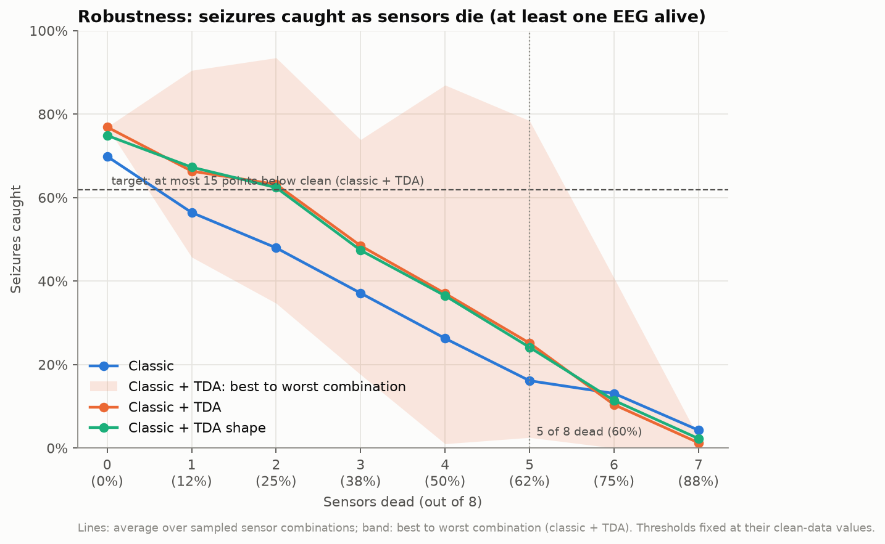 | 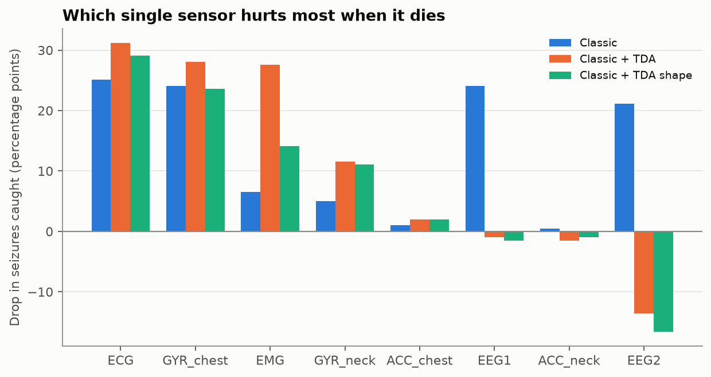 |
|---|---|

#### Test 2: sensor-dropout training (5.3), fixed clean threshold

| Sensors dead | Classic + TDA, caught | False alarms / h | AUROC |
|---|---|---|---|
| 0 | 77.9% | 10.2 | 0.824 |
| 1 | 82.4% | 13.9 | 0.823 |
| 3 | 87.4% | 19.2 | 0.827 |
| **5** | **93.5%** | **28.0** | **0.810** |
| 6 | 94.4% | 29.9 | 0.813 |

The ranking now holds up (AUROC 0.810 with 5 dead), but with one fixed threshold the model **over-alarms** as sensors die: more seizures caught, at nearly three times the false alarms. Every combination formally "passes" (the drop is negative), but this is not a meaningful pass, because the extra sensitivity is bought with false alarms.

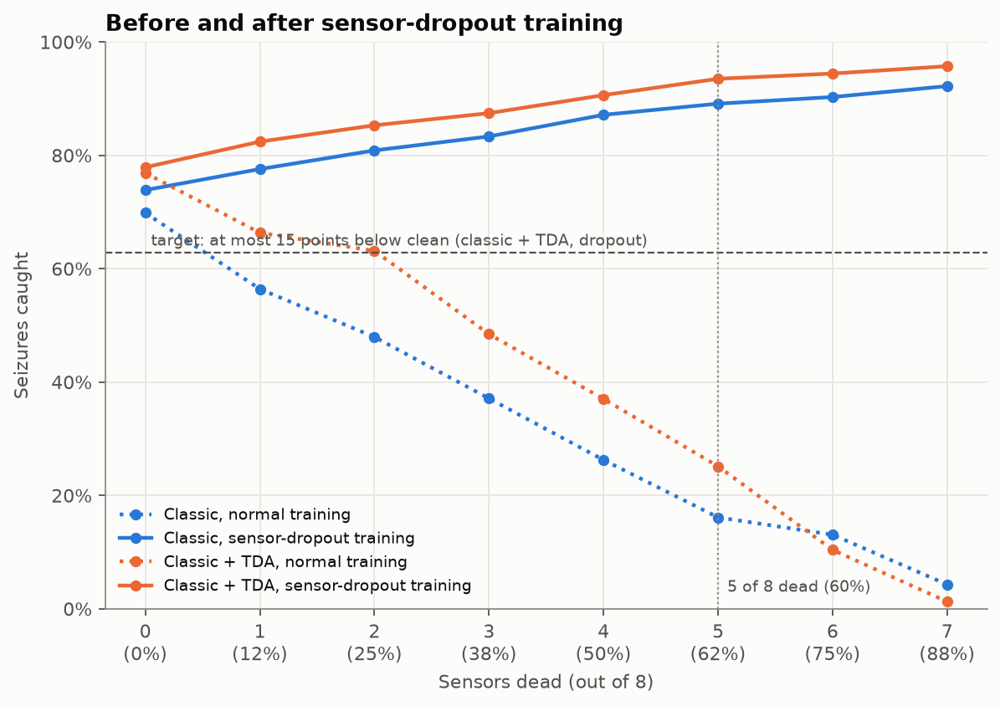

#### Test 3: sensor-aware threshold

A monitor knows which of its sensors are dead (the health check, Step 3), so it can switch to a threshold set in advance for that combination of working sensors. For each combination and each fold, the threshold is chosen **on the other folds' patients, with the same sensors dead**, as the one with the highest sensitivity at ≤ 11 false alarms per hour, then applied to the held-out fold. Every result is therefore at the same false-alarm budget as clean data, which makes the comparison fair.

The search uses the fact that false alarms fall as the threshold rises: a halving search over 46 thresholds (0.01–0.99) finds the lowest one within budget in about 6 scorings, then checks the next 3 up. On the clean predictions it picked exactly the same threshold as trying all 46, in 15 of 15 cases. Scoring uses `FastEvents` ([`metrics.py`](../src/seizure/evaluation/metrics.py)), a vectorised version of the 5.7 scoring that gave identical results on every threshold tested and runs about 5× faster.

Seizures caught, every cell at about 10–11 false alarms per hour (at least one EEG alive):

| Sensors dead | Classic, normal | Classic + TDA, normal | Classic, dropout | **Classic + TDA, dropout** |
|---|---|---|---|---|
| 0 | 69.8% | 76.9% | 73.9% | **77.9%** |
| 1 | 66.4% | 73.0% | 73.1% | **76.9%** |
| 2 | 63.4% | 69.7% | 72.9% | **76.3%** |
| 3 | 64.7% | 70.8% | 73.2% | **77.7%** |
| 4 | 58.5% | 68.5% | 69.0% | **73.9%** |
| **5** | 54.9% | 63.3% | 65.3% | **71.1%** |
| 6 | 55.0% | 60.2% | 66.5% | **71.2%** |
| 7 | 53.5% | 55.0% | 61.6% | **68.1%** |

Target check, 5 of 8 dead:

| Model | Average drop | Worst drop | Combinations passing | False alarms / h |
|---|---|---|---|---|
| Classic, normal training | 14.9 | 27.6 | 5 of 12 | 10.5 |
| Classic + TDA, normal training | 13.6 | 18.6 | 6 of 12 | 10.1 |
| Classic, dropout training | 8.5 | 19.1 | 8 of 12 | 10.4 |
| **Classic + TDA, dropout training** | **6.8** | **18.1** | **10 of 12** | **10.2** |

The two failing combinations for the best model both lose **EEG2** (EEG2 + ECG + three motion sensors: drops of 15.6 and 18.1 points). Whenever EEG2 survives, every combination passes, with a drop of at most 3.5 points. With both EEG channels dead, the best model catches about 46% with 5 sensors dead, which supports limiting the target to combinations with an EEG channel alive.

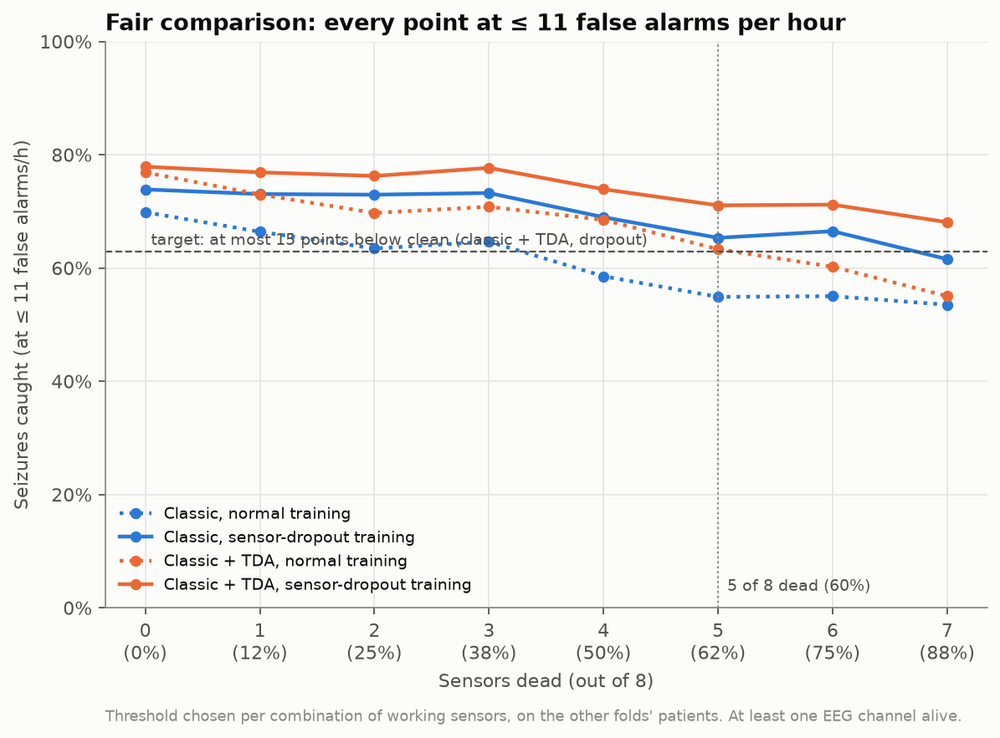

#### What the robustness tests show

1. **Most of the collapse in Test 1 was the threshold, not lost information.** A sensor-aware threshold alone cut the classic + TDA drop from 51.8 to 13.6 points, without retraining.
2. **Dropout training plus a sensor-aware threshold works best:** 71.1% of seizures caught with 5 of 8 sensors dead at 10.2 false alarms per hour, an average drop of 6.8 points.
3. **TDA is more robust than the classic baseline at every failure level**, and the gap widens after dropout training (71.1% vs 65.3% with 5 dead).
4. **EEG2 is the critical sensor.** It is the only sensor whose loss can push the best model past the 15-point limit.

#### Assumptions and limits
- Test 3 assumes the monitor knows **exactly** which sensors are dead. A real health check will sometimes be wrong, so real performance will be somewhat lower; this is tested once the health check exists (Step 3).
- One threshold per combination of working sensors works for 8 sensors (256 combinations) but not for many channels (CHB-MIT's 18 give 262,144). A threshold keyed on how many sensors of each type are working, or "sensor working" flags as model inputs, would scale.
- Results are cross-validation on the 30 pilot patients; the success target is finally judged on the 29 held-out patients.

### Robustness to injected faults (2026-10-23)

([`evaluate.py`](../src/seizure/faults/evaluate.py), [`faults_eval.csv`](../results/tables/faults_eval.csv))

The main experiment: real fault types that start partway through a recording, detected by the health check (Step 3), with the seizure model adapting (Steps 5.3 and 6).

#### Design

- **Faults:** pops, decline, intermittent dropout at 25, 50, 75 and 100% severity (Step 2).
- **Sensor sets (16):** each of the 8 sensors alone; both EEG channels; all 4 motion sensors; 6 random sets of 5 of the 8 sensors with at least one EEG channel fault-free (the target case). 12 fault conditions × 16 sets = 192 scenarios.
- **Assembling a scenario:** the faulty sensors' features are swapped in from the onset, normalised with the patient's **clean** median and MAD (a monitor calibrates before faults appear), and their context features recomputed.
- **Three ways of running the seizure model:**

| Way | What happens |
|---|---|
| A, no health check | Faulty features go in as they are; the fold's fixed clean threshold |
| B, health check | Sensors the health check switches off are blanked for that second; the threshold is the sensor-aware one for the sensors it believes are working |
| C, perfect health check | As B, but using the true labels (failed = effective severity ≥ 0.6) |

- **Models:** classic and classic + TDA with sensor-dropout training, and classic + TDA with normal training. 1,728 results in total.
- **Scoring** as in 5.7. Where nothing is switched off, B and C are identical to A and reuse its result.
- **Run time:** two processes of 6 fault conditions each, about 70 minutes.

```
drop (points) = seizures caught on clean data − seizures caught with the fault
average drop  = mean over the six 5-of-8 sensor sets;   pass if ≤ 15
clean data: classic + TDA 77.9%, classic 73.9% (both with dropout training)
```

#### Faults on 5 of 8 sensors

Seizures caught, classic + TDA:

| Fault | Way | 25% | 50% | 75% | 100% |
|---|---|---|---|---|---|
| Pops | No health check | 74.6% | 68.3% | 61.2% | 52.9% |
| | **Health check** | **77.0%** | **75.5%** | **76.6%** | **76.0%** |
| | Perfect check | 74.6% | 68.3% | 75.5% | 73.7% |
| Decline | No health check | 66.3% | 64.7% | 60.2% | 54.1% |
| | **Health check** | **69.2%** | **68.7%** | **69.2%** | **68.8%** |
| | Perfect check | 66.3% | 64.7% | 70.8% | 71.4% |
| Dropout | No health check | 55.0% | 39.6% | 32.8% | 22.6% |
| | **Health check** | 57.0% | 49.9% | **71.4%** | **76.6%** |
| | Perfect check | 55.0% | 39.6% | 75.0% | 75.0% |

Classic model with the health check, same scenarios: pops 73.3 / 71.9 / 71.1 / 70.8%; decline 60.5 / 61.4 / 63.2 / 58.3%; dropout 57.5 / 57.5 / 67.8 / 70.4%. False alarms with the health check: 6–11 per hour (a few cells reach 11.2, just over the 11 budget).

**Target check, classic + TDA with the health check** (average drop in points):

| Fault | 25% | 50% | 75% | 100% |
|---|---|---|---|---|
| Pops | ✓ 0.9 | ✓ 2.4 | ✓ 1.3 | ✓ 1.9 |
| Decline | ✓ 8.7 | ✓ 9.2 | ✓ 8.7 | ✓ 9.1 |
| Dropout | ✗ 21.0 | ✗ 28.0 | ✓ 6.5 | ✓ 1.4 |

**Met on average in 10 of 12 fault conditions** with the health check, against 3 of 12 without it.

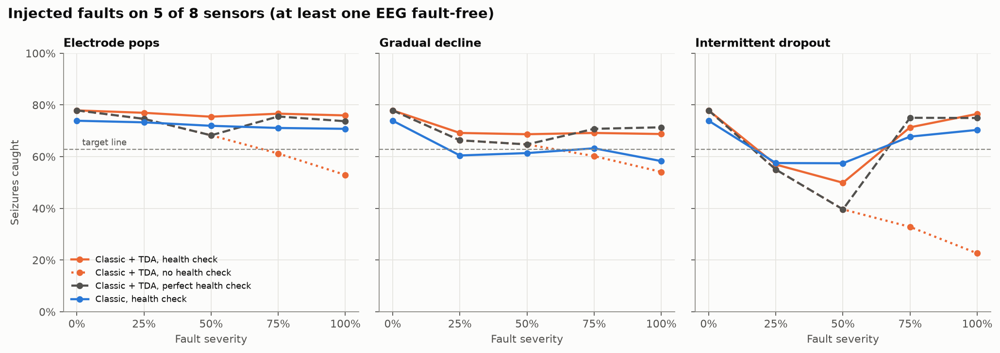

#### Fault on a single sensor

With the health check, a single faulty sensor of any type and severity leaves classic + TDA at **73–79%** of seizures caught, about the same as clean data. Without it, a full dropout on one sensor costs about 23 points (55.2%).

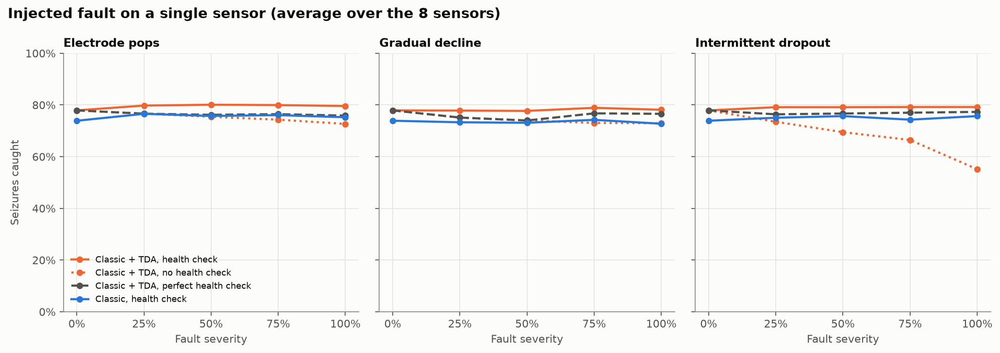

#### What the injected-fault tests show

1. **The health check is what makes the system robust.** At full severity on 5 sensors it turns 22.6% into 76.6% (dropout) and 52.9% into 76.0% (pops).
2. **TDA is more robust than the classic model:** ahead in 10 of 12 conditions with the health check (pops at 100%: 76.0% vs 70.8%; decline at 50%: 68.7% vs 61.4%). The exceptions are the two mild dropouts.
3. **Partial dropout (25–50%) is the weak spot.** Such a sensor is "degraded" by our definition, so it stays on while half its windows are flat. Even the perfect check keeps it on, which is why the perfect check is worse there (39.6% at 50%).
4. **Our health check sometimes beats the "perfect" one,** by switching off badly hit "degraded" sensors. The 0.6 line that defines "failed" is not the best place to draw it; labelling each window by whether its own data is damaged (fix D) addresses this; see the results below.

#### With window-level labels (fix D, 2026-10-23)

The same evaluation, re-run with the health check trained on window-level labels (Step 3.7); the perfect check now also uses window labels. Results of the first version are kept in [`faults_eval_severity_labels.csv`](../results/tables/faults_eval_severity_labels.csv); the tables above (Design, 5-of-8 and single-sensor) describe that first version.

Classic + TDA with the health check, faults on 5 of 8 sensors (clean 77.9%):

| Fault | Labels | 25% | 50% | 75% | 100% |
|---|---|---|---|---|---|
| Dropout | severity | 57.0% | 49.9% | 71.4% | 76.6% |
| | **window** | **75.0%** | **75.6%** | 74.4% | 74.9% |
| Pops | severity | 77.0% | 75.5% | 76.6% | 76.0% |
| | **window** | 78.1% | 77.6% | 78.3% | 76.0% |
| Decline | severity | 69.2% | 68.7% | 69.2% | 68.8% |
| | **window** | 68.7% | 68.3% | 68.7% | 68.6% |

Target check, classic + TDA with the window-label health check (average drop in points; share of the six 5-of-8 sets passing):

| Fault | 25% | 50% | 75% | 100% |
|---|---|---|---|---|
| Pops | ✓ −0.2 (6/6) | ✓ 0.3 (6/6) | ✓ −0.4 (6/6) | ✓ 1.9 (6/6) |
| Decline | ✓ 9.2 (6/6) | ✓ 9.6 (5/6) | ✓ 9.2 (4/6) | ✓ 9.3 (4/6) |
| Dropout | ✓ 2.9 (6/6) | ✓ 2.3 (6/6) | ✓ 3.5 (6/6) | ✓ 3.0 (6/6) |

| Model (health check) | Fault conditions meeting the target, severity labels | Window labels |
|---|---|---|
| **Classic + TDA** | 10 of 12 | **12 of 12** |
| Classic | 9 of 12 | 11 of 12 (misses decline at 100% by 0.1: drop 15.1) |

False alarms with the health check: 5.8–11.6 per hour (a few cells slightly over the 11 budget). A fault on a single sensor leaves classic + TDA at **78–80%** caught for every fault type and severity, equal to or slightly above clean data.

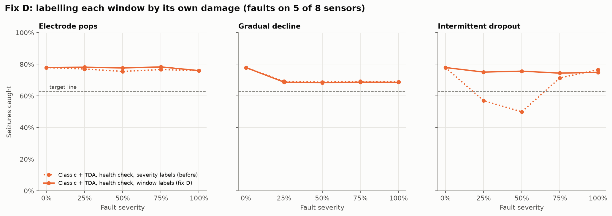

**What fix D shows:**
1. **The partial-dropout gap is closed** (57.0% → 75.0% at 25%, 49.9% → 75.6% at 50%): half-flat windows are now switched off instead of confusing the model.
2. **The complete system** (health check with window labels, sensor-dropout training, sensor-aware threshold) **meets the robustness target in every fault condition** with classic + TDA, and TDA stays ahead of the classic model.
3. **Labelling faults by what is in the window matters**, a methods point for the paper.
4. **Our health check again beats the "perfect" one in places** (dropout 25%: 75.0% vs 69.8%), because it also switches off some damaged windows that are not "failed": the dropout-trained model copes better with a missing sensor than with a damaged one.
5. **Remaining limits:** decline is now the hardest fault (68–69% caught, worst set drop 18.1); resting gyroscopes are over-flagged; a few cells exceed 11 false alarms per hour; all results are cross-validation on 30 pilot patients.

### Final test on held-out patients (2026-10-24)

([`heldout.py`](../src/seizure/data/heldout.py), [`final_test.py`](../src/seizure/models/final_test.py), [`final_clean.csv`](../results/tables/final_clean.csv), [`final_dead_sensors.csv`](../results/tables/final_dead_sensors.csv), [`final_faults.csv`](../results/tables/final_faults.csv))

All results above are cross-validation on the 30 pilot patients, where design choices were made while looking at the numbers. The final test scores patients that were never looked at, **once**.

#### Rules, fixed before any held-out data was read

1. All 29 held-out patients (sub-097 to sub-125, the official SeizeIT2 validation split).
2. Every seizure in a run with all four modalities: no minimum per patient and no cap (the pilot's minimum and cap balanced training; a test counts every seizure, as the benchmark does).
3. Fetch plan as for the pilot, plus at least one 10-minute background chunk per patient.
4. Final models retrained on **all 30** pilot patients: classic and classic + TDA with sensor-dropout training, classic + TDA with normal training, and the window-label health check.
5. Thresholds chosen on the pilot patients' out-of-fold predictions (the saved fold models), at ≤ 11 false alarms per hour, one per set of dead sensors. Clean thresholds: 0.40 (classic + TDA), 0.475 (classic), 0.325 (classic + TDA, normal training). Health cut-off: 0.5 (median of the fold cut-offs).
6. Held-out features normalised per patient exactly as on the pilot (median and MAD of the patient's own seconds, no labels).

**Data:** 26 patients enter (sub-097, sub-120 and sub-121 have no recording with all four modalities), 181 seizures of which **152** are in all-modality runs; 117 seizure chunks and 86 background chunks, 61.8 hours; 216,507 seconds, 8,809 of them seizure. Clean features, fault-injected features (3 faults × 4 severities × 8 sensors) and window labels were built overnight (about 4 hours); the test itself took about 64 minutes. A quick run on one fault condition checked the code beforehand; nothing was changed after it.

#### Clean data

| Model | Seizures caught | False alarms / h | AUROC | AUPR | Median delay |
|---|---|---|---|---|---|
| Classic + TDA, dropout training | 81.6% (124/152) | 13.8 | 0.880 | 0.465 | 6 s |
| Classic, dropout training | 81.6% (124/152) | 12.6 | 0.871 | 0.437 | 6 s |
| Classic + TDA, normal training | 80.9% (123/152) | 13.1 | 0.875 | 0.467 | 6 s |

95% confidence interval for 124/152 (Wilson): **74.7% to 86.9%**:
```
centre     = (p + z²/2n) ÷ (1 + z²/n)                                = 0.808
half-width = z × √( p(1−p)/n + z²/4n² ) ÷ (1 + z²/n)  with z = 1.96  = 0.061
```

- **Sensitivity and ranking hold up** on new patients (81.6% vs 77.9% on the pilot; AUROC 0.880 vs 0.824).
- **False alarms exceed the budget:** 12.6–13.8 per hour against ≤ 11. The thresholds were set on the pilot; the held-out patients produce more seizure-like background, so the same threshold fires more often. Reported as is.
- **On clean data TDA does not beat the classic model:** both catch 124 of 152, with more false alarms for TDA (13.8 vs 12.6). TDA still ranks slightly better (AUROC 0.880 vs 0.871, AUPR 0.465 vs 0.437). The pilot's clean-data gap (+7 points) does not replicate.
- Against the SeizeIT2 benchmark (SVM 71.1% at 11.0 per hour) this is in the same range but not directly comparable (data concentrated around seizures; full recordings in the benchmark).

#### Dead sensors (sensor-aware threshold, at least one EEG alive)

| Sensors dead | 0 | 1 | 2 | 3 | 4 | **5** | 6 | 7 |
|---|---|---|---|---|---|---|---|---|
| Classic + TDA, dropout | 81.6% | 80.9% | 80.5% | 79.8% | 76.6% | **72.5%** | 72.3% | 70.4% |
| Classic, dropout | 81.6% | 79.8% | 79.0% | 77.2% | 74.7% | **70.4%** | 71.2% | 67.4% |
| Classic + TDA, normal training | 80.9% | 78.5% | 76.8% | 76.8% | 64.6% | **59.1%** | 65.2% | 57.6% |

| 5 of 8 dead | Average drop | Worst drop | Sets passing | False alarms / h |
|---|---|---|---|---|
| **Classic + TDA, dropout** | **9.1** | 19.1 | **11 of 12** | 11.2 |
| Classic, dropout | 11.2 | 19.7 | 10 of 12 | 11.8 |
| Classic + TDA, normal training | 21.8 | 69.1 | 7 of 12 | 11.7 |

The pilot result replicates: with dropout training and a sensor-aware threshold the drop stays within 15 points (pilot 6.8), and TDA is the most robust model. Without dropout training the target is missed. With one fixed threshold the dropout-trained models over-alarm again (27 per hour with 5 dead), as on the pilot.

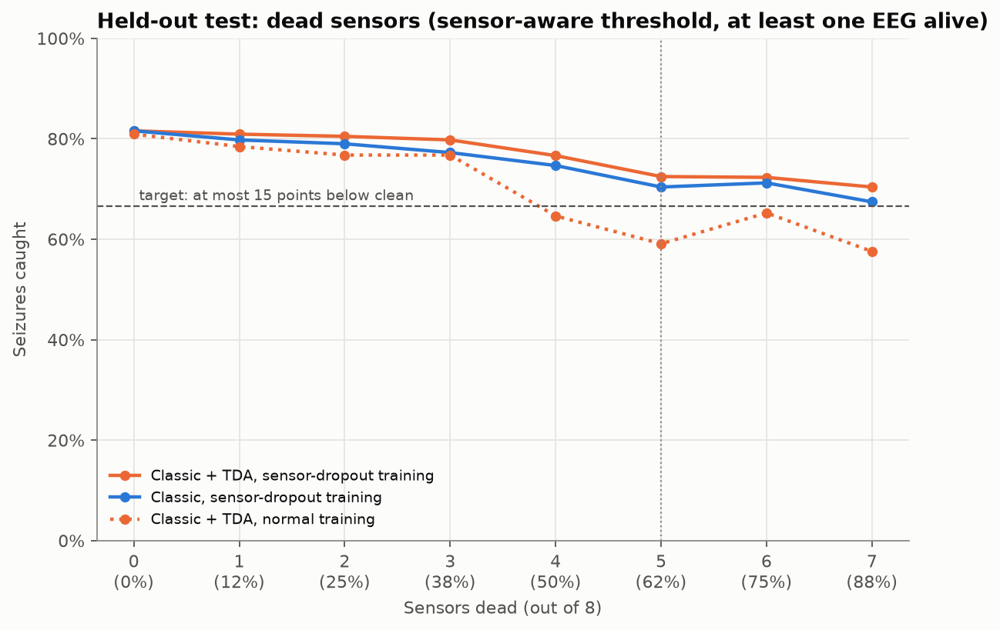

#### Injected faults on 5 of 8 sensors

Seizures caught, classic + TDA with dropout training (clean 81.6%):

| Fault | Way | 25% | 50% | 75% | 100% |
|---|---|---|---|---|---|
| Pops | No health check | 79.7% | 80.3% | 75.4% | 74.2% |
| | Health check | 81.3% | 82.1% | 79.2% | 78.4% |
| Decline | No health check | 75.3% | 70.8% | 70.3% | 65.5% |
| | Health check | 75.3% | 74.8% | 75.4% | 73.0% |
| Dropout | No health check | 67.4% | 61.1% | 46.7% | 30.3% |
| | Health check | 77.4% | 78.6% | 76.6% | 75.8% |

Target check with the health check (average drop; sets passing of 6):

| Fault | Classic + TDA | Classic |
|---|---|---|
| Pops | 0.3 / −0.5 / 2.4 / 3.2 (all 6/6) | 1.8 / 2.0 / 4.2 / 4.1 (all 6/6) |
| Decline | 6.3 / 6.8 / 6.1 / 8.6 (6, 6, 6, 5 of 6) | 13.2 / 10.7 / 13.6 / 13.9 (3, 5, 3, 3 of 6) |
| Dropout | 4.2 / 3.0 / 4.9 / 5.8 (all 6/6) | 6.1 / 3.9 / 5.0 / 7.9 (all 6/6) |

| Fault conditions meeting the target | No health check | Health check | Perfect check |
|---|---|---|---|
| **Classic + TDA, dropout** | 8 of 12 | **12 of 12** | 12 of 12 |
| Classic, dropout | 7 of 12 | 12 of 12 | 11 of 12 |
| Classic + TDA, normal training | 6 of 12 | 11 of 12 | 12 of 12 |

- **The complete system meets the target in all 12 fault conditions on new patients**, as on the pilot.
- **TDA is more robust than the classic model under faults** even though it is not better on clean data: smaller drops in every fault type, most clearly for decline (6–9 points vs 11–14; every set passes vs 50–80%).
- **The health check is essential:** a full dropout on 5 sensors leaves 30.3% without it and 75.8% with it.
- **A fault on a single sensor** leaves classic + TDA with the health check at 80.5–82.4%, the same as clean data.
- **Both EEG channels faulty:** with the health check classic + TDA still catches 76–82% on these patients; the remaining sensors carry enough once the broken EEG is switched off.
- **False alarms under faults** with the health check: 10.3–13.9 per hour, in line with the clean held-out rate; the same threshold-transfer issue.

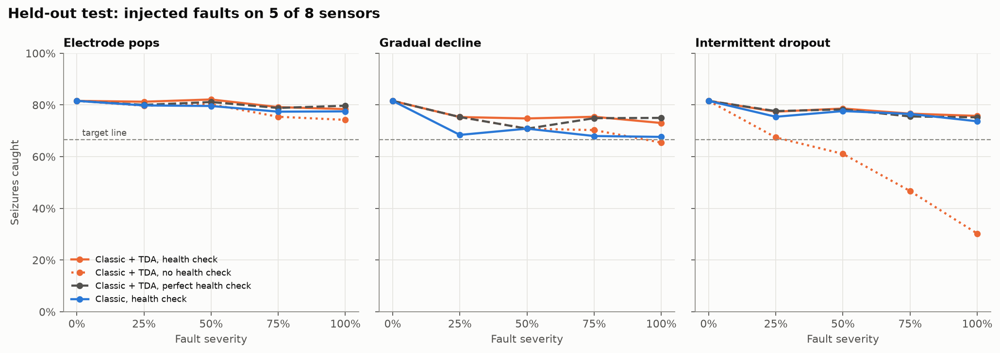

#### Health check on new patients (single-sensor faults; share of windows switched off by true window label)

| Fault | Truly failed | Truly degraded | "Healthy" windows inside a fault |
|---|---|---|---|
| Dropout | 94.4% | 69.4% | 56.3% |
| Decline | 80.4% | 21.8% | 13.0% |
| Pops | 77.4% | 46.5% | 35.7% |

It catches 77–94% of failed windows on unseen patients. Many "healthy" windows inside a fault (the gaps between pops or dropout bursts) are also switched off; that is the 30 s hysteresis keeping an unreliable sensor off, as intended. Switch-offs of sensors with no fault at all were not measured separately on the held-out set.

#### Pilot vs held-out

| Claim | Pilot (cross-validation) | Held-out | Holds? |
|---|---|---|---|
| Clean ≥ 60% at ≤ 11 false alarms/h (T1) | 77.9% at 10.2 | 81.6% at **13.8** | sensitivity yes; **false alarms over budget** |
| TDA beats classic on clean data | +7.1 points | 0 points | **no** |
| 5 of 8 dead, sensor-aware threshold: drop ≤ 15 | 6.8 | 9.1 | yes |
| Injected faults with health check: target met | 12 of 12 | 12 of 12 | yes |
| TDA more robust than classic under faults | yes | yes, smaller drops in every fault type | yes |
| Health check essential | yes | yes | yes |

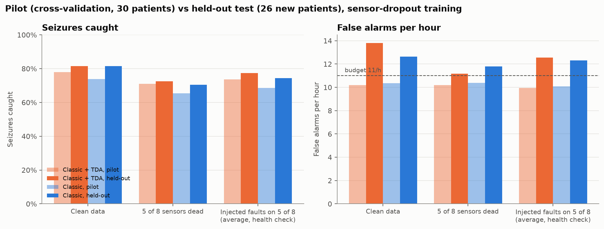

**Headline for the paper.** A seizure detector combining TDA features, sensor-dropout training, a health check and sensor-aware thresholds keeps detection within 15 points of its clean performance when 5 of 8 wearable sensors fail or degrade, on patients it never saw. TDA's contribution is robustness to faults rather than clean accuracy. The main weakness is false alarms above the budget on new patients (about 13–14 per hour). No threshold or setting was changed after seeing held-out results; ways to address this (calibration period, more training patients, tuning) are future work.

---

## Phase A: after the held-out test (2026-10-24)

The held-out test showed two weaknesses: false alarms above the 11 per hour budget on new patients (13.8), and no clean-data advantage for TDA. Phase A addresses the first, and adds fault-augmented training. **The held-out set is not used in Phase A**: every choice is made by cross-validation on training patients; a second held-out run (v2) will be reported alongside v1 at the end.

### A1: train on all 90 usable training patients ([`fullset.py`](../src/seizure/data/fullset.py), [`phase_a.py`](../src/seizure/models/phase_a.py))

Rules for the other 66 training-range patients, fixed before building: every patient, every seizure in all-modality runs with at most 10 per patient (seed 42), at least one 10-minute background chunk each. 60 have a recording with all four modalities: 155 seizures, 72.4 hours, built with `SEIZURE_SET=extra` (clean features 47 min, faulty features 4 h; window labels needed 3 workers instead of 6 to fit in memory). Together with the pilot: **90 patients, 551,429 seconds, 24,882 seizure seconds**.

5-fold cross-validation over the 90 patients (dropout training, threshold at ≤ 11 per hour on the other folds):

| | Pilot CV (30) | A1 CV (90) |
|---|---|---|
| Classic + TDA: caught / FA per h | 77.9% / 10.2 | 71.9% / 10.3 |
| Classic: caught / FA per h | 73.9% / 10.3 | 70.8% / 10.6 |
| AUROC (TDA / classic) | 0.824 / 0.813 | 0.851 / 0.841 |
| AUPR (TDA / classic) | 0.331 / 0.253 | 0.440 / 0.385 |

Ranking improves with more patients; sensitivity is lower because the extra patients (many with 1–2 seizures, more unusual) are harder than the pilot's (chosen with at least 3 seizures). But **2 of 5 folds exceed 11 false alarms per hour** (11.7 and 12.7): the same transfer problem as the held-out test.

### A2: a threshold that keeps the budget on unseen patients

Four strategies, each chosen on the other folds only and judged by the held-out fold's false alarms:

| Strategy (classic + TDA) | Caught | FA / h | Worst fold | Folds over 11 |
|---|---|---|---|---|
| Current: best at ≤ 11 per hour | 71.9% | 10.3 | 12.7 | 2 |
| Margin: best at ≤ 10 | 71.1% | 9.8 | 12.7 | 1 |
| Margin: best at ≤ 9 | 69.1% | 8.8 | 11.3 | 1 |
| **Margin: best at ≤ 8** | **67.0%** | **7.7** | **9.7** | **0** |
| Margin, budget chosen by nested CV | 68.3% | 8.6 | 11.3 | 1 |
| Per patient: max(threshold, own 95th percentile) | 67.0% | 6.1 | 6.7 | 0 |
| Stricter alarm, 6–8 of 10 | 70.8–72.6% | 10.3–10.6 | 12.6–12.9 | 2–3 |

```
margin rule:       threshold = best threshold at ≤ b false alarms/h on training patients, b = 8
per-patient rule:  threshold(patient) = max(margin-free threshold, q-th quantile of that patient's own probabilities)
```

A stricter alarm does not help: false alarms come in long bursts. **Adopted: the margin rule at 8 per hour** (`train.SELECT_BUDGET`), judged against the 11 budget. Per-patient calibration gives the best numbers but its quantile depends on how much of a patient's data is seizure, which is high in our seizure-centred chunks and low in real 24-hour monitoring; it would need a seizure-free calibration period, so it is reported as an alternative. Cost of the margin rule: about 5 points of sensitivity for a budget that holds.

### A3: training with injected faults ([`phase_a3.py`](../src/seizure/models/phase_a3.py))

**Why:** the model had only practised with dead sensors, but the health check passes on sensors it judges healthy or degraded, so the model also sees damaged-but-on data.

**How:** for each of the 12 fault conditions, a random set of 1–5 sensors is made faulty from the onset (the fault build of Step 2); a random 5% of the seconds after the onset are added to training, with every truly failed window blanked, because the health check would switch that sensor off. About 196,000 rows; each fold uses only its training patients' rows. **A1** = clean + dead-sensor copy; **A3** = A1 + fault rows. The health check was retrained on the same 90-patient folds (7% of whole series per patient to fit in memory; cut-offs 0.5–0.55). Thresholds at ≤ 8 per hour; judged at 11. Two models per fold were trained from one pre-allocated table, A1 on the first two thirds and A3 on all of it, to fit in memory. Run time about 2 h 20 min.

**Health check on 90 patients:** truly failed windows switched off 84.1%, degraded 30.2%. **Sensors with no fault switched off:** EEG1 0.1%, EEG2 0.2%, EMG 0.1%, ECG 1.1%, accelerometers 0.1–0.6%, gyroscopes 18–26%.

**Clean data, every fold within the budget:**

| Model | Caught | FA / h | FA per fold | Folds over 11 | AUPR |
|---|---|---|---|---|---|
| A1 classic | 66.8% | 7.7 | 8.5 6.2 9.9 6.9 7.0 | 0 | 0.382 |
| A1 classic + TDA | 67.3% | 7.5 | 9.4 5.7 9.0 6.5 7.2 | 0 | 0.442 |
| A3 classic | 67.5% | 7.5 | 8.9 4.9 9.2 7.2 7.1 | 0 | 0.382 |
| **A3 classic + TDA** | **67.5%** | **7.3** | 9.0 5.8 8.0 6.8 7.4 | **0** | **0.445** |

**Faults on 5 of 8 sensors with the health check** (caught at 25 / 50 / 75 / 100%):

| Fault | A1 classic + TDA | A3 classic + TDA | A3 classic |
|---|---|---|---|
| Decline | 60.0 / 58.1 / 58.3 / 56.5% | **64.6 / 63.3 / 62.0 / 61.0%** | 61.1 / 60.8 / 58.4 / 58.4% |
| Dropout | 61.7 / 61.9 / 61.4 / 61.7% | **65.3 / 62.1 / 60.9 / 60.7%** | 63.4 / 61.2 / 58.2 / 57.8% |
| Pops | 65.9 / 64.0 / 63.9 / 63.4% | **68.0 / 65.8 / 64.3 / 63.6%** | 64.7 / 63.5 / 63.0 / 62.5% |

Average drop in points (sets passing of 6):

| Fault | A1 classic + TDA | **A3 classic + TDA** | A3 classic |
|---|---|---|---|
| Decline | 7.3 / 9.2 / 9.0 / 10.8 (6, 6, 5, 4) | **2.9 / 4.3 / 5.5 / 6.5 (all 6)** | 6.4 / 6.7 / 9.1 / 9.1 (6, 6, 5, 4) |
| Dropout | 5.6 / 5.3 / 5.8 / 5.6 (all 6) | **2.3 / 5.5 / 6.6 / 6.9 (all 6)** | 4.1 / 6.4 / 9.3 / 9.7 (6, 6, 5, 4) |
| Pops | 1.4 / 3.2 / 3.4 / 3.8 (all 6) | **−0.5 / 1.7 / 3.2 / 3.9 (all 6)** | 2.9 / 4.0 / 4.6 / 5.0 (all 6) |

| Fault conditions meeting the target | No health check | Health check |
|---|---|---|
| A1 classic | 3 of 12 | 11 of 12 |
| A3 classic | 9 of 12 | 12 of 12 |
| A1 classic + TDA | 5 of 12 | 12 of 12 |
| **A3 classic + TDA** | **8 of 12** | **12 of 12, all 72 sensor sets** |

False alarms with the health check: 5.2–9.2 per hour in every scenario; none above 11.

**What Phase A shows:**
1. Training on 90 patients gives a more realistic, better-ranking model, and confirms the false-alarm transfer problem.
2. Choosing the threshold at 8 per hour on training patients keeps the 11 budget on every unseen fold, in clean data and in all fault scenarios, at a cost of about 5 points of sensitivity (71.9% → 67.5% on clean data).
3. Fault-augmented training costs nothing on clean data and fixes the weakest fault: gradual decline drops 3–6.5 points instead of 7–11, and every individual sensor set passes.
4. TDA keeps its pattern: about the same clean sensitivity as classic (better AUPR, 0.445 vs 0.382), and more robust under faults.
5. Limits: still cross-validation (held-out v2 pending); gyroscopes over-flagged; the margin trades sensitivity for false-alarm reliability, and both operating points should be reported.

---

## Phase B: TDA-B and the CNN baseline (2026-10-24/25)

### B0: a local copy of the signals ([`signals.py`](../src/seizure/data/signals.py))

TDA-B and the CNN need the signal itself, again and again; re-streaming was ruled out (see [data-access.md](data-access.md#8-caching)). For every chunk in the three fetch plans: stream, clean as for the features (Step 1.4), downsample with causal filters (EEG1, EEG2, ECG to 64 Hz; EMG to 128 Hz, since its content is above 20 Hz; motion magnitudes stay at 25 Hz), and store with the patient's normalisation statistics. 116 patients, 1.24 GB, about 25 minutes (much faster than the feature build, since there is no TDA).

### B1: TDA-B, the topology of the sensor network ([`tda_network.py`](../src/seizure/features/tda_network.py), [`phase_b1.py`](../src/seizure/models/phase_b1.py))

**Per second t:**
```
activity(sensor)  = log10 RMS of the normalised signal in 0.25 s steps over the last 10 s   (40 values)
distance(i, j)    = 1 − |Pearson correlation of activity(i) and activity(j)|
persistent homology of the distance matrix (ripser): H0 (sensors merging) and H1 (loops)
```
9 features that do not depend on how many sensors are working: mean / min / max of the H0 merge distances and their entropy, H1 count / total / max, mean |correlation|, and the share of pairs with |correlation| > 0.5. A dead sensor is left out of the network (fewer than 3 working sensors: missing). About 0.1 ms per second of data. Because TDA-B depends on which sensors are alive **together**, it is recomputed without the dead sensors: per row of the dropout copy and per dead-sensor combination.

**Test:** classic + TDA vs classic + TDA + TDA-B, sensor-dropout training, 90 patients, 5 folds, thresholds at ≤ 8 per hour on the other folds, the 102 dead-sensor sets. About 3 hours.

| Model | Clean: caught | FA / h | AUROC | AUPR | 5 of 8 dead: mean drop (sets passing) |
|---|---|---|---|---|---|
| Classic + TDA | 68.8% | 7.6 | 0.851 | 0.443 | 9.8 (8 of 12) |
| + TDA-B | 69.3% | 7.7 | 0.852 | 0.443 | 10.3 (7 of 12) |

Paired over the 71 dead-sensor sets with an EEG alive:
```
difference = caught (with TDA-B) − caught (without):  mean −0.09 points; 33 better, 33 worse, 5 tied
Wilcoxon signed-rank test: p = 0.54
```
For scale, the same classic + TDA model caught 67.3% in A1 and 68.8% here, differing only in the random dead-sensor pattern of the dropout copy: about ±1.5 points of run-to-run variation.

**Result: on SeizeIT2, TDA-B adds nothing measurable**, on clean data or with dead sensors. Likely reasons: at most 8 nodes, half of them motion magnitudes that move together, give little shape (H1 barely exists; H0 is close to the average correlation); per-sensor features with 10 s and 60 s context already capture "everything changes at seizure onset"; and cross-modality coupling changes only slightly in focal seizures. This is the limitation anticipated in Step 4B. The injected-fault round for TDA-B on SeizeIT2 was skipped for that reason; TDA-B will be tested on CHB-MIT (18 EEG channels), where the network hypothesis is natural.

### B2: CNN baseline ([`cnn.py`](../src/seizure/models/cnn.py))

Trained on the GPU (RTX 4050, 6 GB; about 10× faster than the CPU). Install: `pip install torch --index-url https://download.pytorch.org/whl/cu128`.

**v1:** four convolutional branches on the last 4 s of EEG1+EEG2 (2 × 256), 15 s of ECG (960), 4 s of EMG (512) and 4 s of motion (4 × 100), pooled and joined with 8 "sensor working" flags; 283,000 parameters; dead sensors as zero input and flag 0; sensor dropout on the fly (half the windows lose 1–6 sensors); weighted loss; 8 epochs per fold. **v2:** the v1 encoder per second plus a GRU over the last 60 s of encodings (the same context as the XGBoost features); dropout as one dead set per chunk.

| Model (90 patients, same folds and threshold rule) | Caught | FA / h | AUROC | AUPR | 5 of 8 dead: mean drop |
|---|---|---|---|---|---|
| XGBoost classic + TDA (A1) | 67.3% | 7.5 | 0.852 | 0.442 | 9.8 |
| CNN v1 | 40.9% | 7.5 | 0.691 | 0.183 | −3.3 |
| CNN v2 (+ GRU, 60 s) | 39.9% | 7.9 | 0.689 | 0.156 | −6.2 |

Context did not help because the bottleneck is the frozen v1 encoder: memory cannot add information the per-second encoding lacks. Losing the ECG raises the CNN (to 47–50%), so its ECG branch adds noise. The CNN's flat or rising curve under sensor loss reflects its low starting point, not robustness. **Hand-made features (classic + TDA) clearly beat a deep model learned from raw signals across 90 patients**, in line with deep wearable seizure benchmarks such as SeizeIT2's ChronoNet (100.5 false alarms per hour). An end-to-end CNN + GRU with balanced sampling is on hold.

---

## Phase C: statistics, ablations, live timing and real broken sensors (2026-10-24)

### C1 + C2: what each part of the system contributes ([`phase_c.py`](../src/seizure/models/phase_c.py))

**Variants.** Each removes one part of the full system (A3 classic + TDA, health check, sensor-aware threshold); 90 patients, the same 5 folds, thresholds at ≤ 8 per hour on the other folds:

| Variant | What changes | Model |
|---|---|---|
| full | nothing | A3 classic + TDA (263 features) |
| −TDA | no TDA features | A3 classic (111) |
| −TDA size | TDA shape summaries only | new (183) |
| −TDA shape | TDA size summaries only | new (191) |
| −memory | no _m10 / _d60 context | new (93) |
| −fault train | dropout copy only | A1 classic + TDA |
| −robust train | no dropout copy, no fault rows | new |
| −health check | faulty sensors stay on, one fixed threshold | full |
| −sensor-aware | health check on, one fixed threshold | full |

Each variant is scored per patient (seizures caught, seizures, false alarms, hours) on clean data and on the 12 fault conditions × 6 five-of-eight sensor sets (Step 8). Four new model sets were trained (about 30 min) and everything scored in 2 h 10 min.

**Statistics: a bootstrap over patients.** Seconds of the same patient are not independent, so patients are resampled, not seconds:
```
for b = 1 … 2000:   draw 90 patients with replacement (seed 42)
                    sensitivity_b = Σ caught / Σ seizures over the drawn patients (same for false alarms per hour)
95% interval        = 2.5th and 97.5th percentiles of the 2000 values
paired difference   = sensitivity_b(full) − sensitivity_b(variant), on the same drawn patients
p (one-sided)       = share of draws where the full system is not better (difference ≤ 0)
```
Example: if, in 37 of the 2000 draws, the variant catches at least as many as the full system, p = 37 / 2000 = 0.0185. Under faults, sums run over all 72 scenarios.

**Results** (sensitivity [95% interval], false alarms per hour; difference = full − variant, in points):

| Variant | Clean | Faults on 5 of 8 | Difference under faults [95%] | p |
|---|---|---|---|---|
| **full** | **67.5% [54–81], 7.3** | **63.5% [51–76], 7.1** | | |
| −TDA | 67.5%, 7.5 | 61.1%, 7.2 | **+2.4 [0.1, 4.8]** | **0.019** |
| −TDA size | 68.5%, 7.5 | 64.0%, 7.0 | −0.5 [−1.4, 0.4] | 0.85 |
| −TDA shape | 68.3%, 7.8 | 62.8%, 7.4 | +0.6 [−0.9, 2.2] | 0.21 |
| −memory | 53.4%, 7.6 | 50.5%, 7.1 | **+13.0 [8.6, 17.3]** | < 0.001 |
| −fault train | 67.3%, 7.5 | 61.4%, 6.9 | **+2.1 [1.2, 3.1]** | < 0.001 |
| −robust train | 67.3%, 7.5 | 56.0%, 7.2 | **+7.5 [5.4, 9.7]** | < 0.001 |
| −health check | 67.5%, 7.3 | 52.2%, 5.1 | **+11.2 [8.7, 13.8]** | < 0.001 |
| −sensor-aware | 67.5%, 7.3 | 69.4%, **10.3 [9.3, 11.4]** | −5.9 | (false alarms over budget) |

**What it shows:**
1. **TDA helps under faults, not on clean data:** the same clean sensitivity, but 2.4 points more under faults, with an interval that excludes 0 (p = 0.019). This is the project's central claim, now with patient-level uncertainty.
2. TDA size and shape summaries are interchangeable: removing either one alone costs nothing; removing both costs 2.4 points.
3. The 10 s / 60 s memory is the largest single part (13–14 points, clean and faulty).
4. Robustness comes from three parts that add up: the health check (11.2), dropout training (about 5.4 on top of fault training) and fault training (2.1).
5. Without sensor-aware thresholds the model catches more but raises 10.3 false alarms per hour (upper bound 11.4), over the 8 used for selection; the sensor-aware thresholds are what keep the budget when sensors switch off.

### C3: live run and timing ([`live.py`](../src/seizure/models/live.py))

Three training patients (sub-004, sub-076, sub-031), 600 s each, played second by second through the whole system with the fold-0 models: re-clean the last 75 s, features for the window ending now, quality features, context from the history, health check with its 15 s smoothing, the stuck rule (C4), the seizure model with switched-off sensors blanked, and the 5-of-10 alarm. Laptop CPU (no GPU), one process:

| Step | Mean (ms) | 99th percentile (ms) |
|---|---|---|
| Cleaning (last 75 s) | 4.7 | 5.4 |
| Features (classic + TDA-A) | 42.7 | 50.2 |
| Quality features | 5.5 | 6.7 |
| Context | 10.8 | 14.3 |
| Health check | 8.3 | 9.9 |
| Stuck rule | 0.4 | 0.6 |
| Seizure model | 13.5 | 17.4 |
| **Total** | **86.0** | **101.9 (max 119.7)** |

All 1,800 seconds were processed within 0.2 s: **the system runs about 10× faster than real time** on a laptop. TDA-A (persistent homology of 150-point clouds) is the largest part, about half.

### C4: real broken motion sensors ([`real_faults.py`](../src/seizure/faults/real_faults.py))

Step 1.4 found genuinely broken motion sensors in SeizeIT2 and removed them. Here they are kept and passed through the system. Scan of all 569 chunks of the 90 patients (2,276 motion sensor-chunks): 2,056 healthy, 79 missing, 48 accelerometers with a wrong scale (gravity outside 0.1–1.5), 93 labelled stuck by preprocess.stuck (20 patients).

**Wrong scale:** caught every time, at cleaning (the gravity calibration fails), before the health check.

**Stuck: the learned health check alone is not enough.** It sees the magnitude of the three axes, and a single frozen axis hides behind the two moving ones; frozen axes were also not among the simulated faults. Rather than rebuild the fault set, a rule was added in front of the health check ([`health.stuck_motion`](../src/seizure/faults/health.py)), on the past 60 s only:
```
switch a motion sensor off if any axis, over the last 60 s:
  sits at its full-scale limit (from the EDF header) for more than half of the samples, or
  is exactly constant, except: a gyroscope at 0 (within 2 quantisation steps)
                               counts only if the same device's accelerometer is also frozen
```
Why this form: healthy sensors at rest flicker between one or two quantised values, so "pinned at the window's own min / max" (the definition of preprocess.stuck) fires on them; and a gyroscope at rest reads exactly 0 for minutes. Stuck accelerometers in SeizeIT2 sit at ±32.767 (the full scale); dead devices read 0 on every axis.

| Rule on all 2,056 healthy motion sensor-chunks | Share of seconds switched off |
|---|---|
| Window's own min / max (rejected) | 13.4% |
| Any exact constant (rejected) | 3.8% |
| **Full-scale or constant, gyroscope-at-rest exemption, 60 s** | **0.6%** |
| Same, 300 s window | 0.1% |

**Stuck sensor-chunks (93), share of seconds switched off:**

| | Health check | Rule | Both |
|---|---|---|---|
| Pinned at full scale or dead device (68) | 95.5% | 94.0% | **99.7%** |
| Labelled stuck only by the window min / max test (25) | 10% | 3% | 11% |
| Matched healthy controls (93) | 5.6% | 0.5% | 6.0% |

The 25 chunks that nothing switches off are mostly gyroscopes at 0 while the accelerometer moves, or accelerometers pinned at their own min / max: the same signature as a sensor at rest, so they are most likely not faults. **Result: every genuinely broken motion sensor found in SeizeIT2 (wrong scale, pinned at full scale, dead device) is switched off, in 99.7–100% of its seconds, at a cost of 0.4 ms per second and 0.6% extra switch-off of healthy motion sensors.** Gyroscopes remain the sensors the health check over-flags (Phase A3).

---

## Timeline (model in 1 week)

| Day | Work |
|---|---|
| 1 | Streaming loader, labels, cleaning, windowing (Step 1) |
| 2 | Fault injection and health check (Steps 2–3) |
| 3 | TDA-A features; check speed (Step 4A) |
| 4 | TDA-B and classic features (Steps 4B, 4C) |
| 5 | XGBoost with dropout augmentation; first cross-validation results (Step 5) |
| 6 | CNN baseline; alarm-rule tuning (Steps 5.6, 6) |
| 7 | Streaming replay; first robustness curves (Steps 7, 8) |

Weeks 2–3: full experiment grid, CHB-MIT, ablations, writing.

**Split:**
- Person A: Steps 1–3.
- Person B: Step 4 (start on synthetic signals until data is ready).
- Together: Step 5 onward.

## References
- Bhagubai et al., *SeizeIT2: Wearable Dataset Of Patients With Focal Epilepsy*, arXiv:2502.01224 (2025). https://arxiv.org/html/2502.01224v1
- CHB-MIT Scalp EEG Database, PhysioNet. https://physionet.org/content/chbmit/1.0.0/
